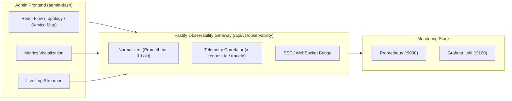

# Observability & Telemetry Integration Guide (Admin Dashboard)

This document specifies the complete API contracts, request/response schemas, telemetry correlation, and data structures required to integrate the observability platform into the Admin Dashboard (`admin-dash`), optimized for **React Flow system topology graphs**, **telemetry pipeline visualizations**, and **real-time log & metric explorers**.

---

## 1. System & Telemetry Architecture

All telemetry data (Metrics, Logs, Traces/Spans) is collected by the backend, normalized, and exposed exclusively via Fastify endpoints under `/api/v1/observability`.



* **Authentication**: Requires standard Admin JWT (`Authorization: Bearer <accessToken>`).
* **Permissions**: `system:manage` or `dashboard:read`.
* **Telemetry Correlation**: Every HTTP log line, metric label, and error report carries `x-request-id` (correlated with Loki `reqId` and Prometheus request buckets).

---

## 2. API Endpoints Specification (Request & Response Contracts)

### 2.1. Metric Presets (Service Catalog)

Retrieves all pre-configured KPI queries with recommended units and step resolutions.

* **Method**: `GET`
* **Route**: `/api/v1/observability/metrics/presets`
* **Headers**:
  ```http
  Authorization: Bearer <accessToken>
  ```
* **Request Parameters**: None

* **Response (`200 OK`)**:
```json
{
  "success": true,
  "status": "success",
  "data": [
    {
      "id": "http_request_rate",
      "title": "HTTP Request Rate",
      "description": "Requests handled per second across API routes",
      "unit": "req/s",
      "category": "http",
      "query": "sum(rate(http_requests_total[1m])) or rate(http_requests_total[1m])",
      "defaultStep": "15s"
    },
    {
      "id": "http_error_rate",
      "title": "5xx Error Percentage",
      "description": "Percentage of requests resulting in internal server errors",
      "unit": "%",
      "category": "http",
      "query": "(sum(rate(http_requests_total{status=~\"5..\"}[1m])) / sum(rate(http_requests_total[1m]))) * 100 or vector(0)",
      "defaultStep": "15s"
    },
    {
      "id": "http_latency_p95",
      "title": "P95 Request Latency",
      "description": "95th percentile HTTP request duration in milliseconds",
      "unit": "ms",
      "category": "http",
      "query": "histogram_quantile(0.95, sum(rate(http_request_duration_seconds_bucket[1m])) by (le)) * 1000",
      "defaultStep": "15s"
    },
    {
      "id": "process_cpu_usage",
      "title": "Process CPU Usage",
      "description": "CPU time consumed by the Node.js API runtime",
      "unit": "%",
      "category": "system",
      "query": "rate(process_cpu_user_seconds_total[1m]) * 100",
      "defaultStep": "15s"
    },
    {
      "id": "process_memory_mb",
      "title": "Resident Memory (RSS)",
      "description": "Total physical memory allocated by the API process",
      "unit": "MB",
      "category": "system",
      "query": "process_resident_memory_bytes / 1024 / 1024",
      "defaultStep": "30s"
    },
    {
      "id": "node_event_loop_lag",
      "title": "Event Loop Lag",
      "description": "Node.js main thread scheduling delay",
      "unit": "ms",
      "category": "system",
      "query": "nodejs_eventloop_lag_p95_seconds * 1000 or nodejs_eventloop_lag_seconds * 1000",
      "defaultStep": "15s"
    }
  ]
}
```

---

### 2.2. Metrics Range Query (Time-Series Charts)

Queries Prometheus for time-series data points over a given time window, normalized into clean numerical points with summary statistics.

* **Method**: `GET`
* **Route**: `/api/v1/observability/metrics/range`
* **Headers**:
  ```http
  Authorization: Bearer <accessToken>
  ```
* **Query Parameters**:

| Parameter | Type | Required | Default | Description | Example |
|---|---|---|---|---|---|
| `preset` | `string` | Optional* | - | ID from presets endpoint | `http_request_rate` |
| `query` | `string` | Optional* | - | Custom PromQL expression | `rate(http_requests_total[1m])` |
| `start` | `string` | No | 1h ago | ISO-8601 or epoch seconds | `2026-10-18T06:00:00Z` |
| `end` | `string` | No | Now | ISO-8601 or epoch seconds | `2026-10-18T07:00:00Z` |
| `step` | `string` | No | Auto | Resolution step interval | `15s`, `1m`, `5m` |

*\* Note: Either `preset` or `query` must be provided.*

* **Response (`200 OK`)**:
```json
{
  "success": true,
  "status": "success",
  "data": {
    "success": true,
    "query": "sum(rate(http_requests_total[1m]))",
    "start": "2026-10-18T06:00:00.000Z",
    "end": "2026-10-18T07:00:00.000Z",
    "step": "15s",
    "seriesCount": 1,
    "series": [
      {
        "id": "http_requests_total{container=meeo-api,method=GET}",
        "name": "GET /api/v1/catalog [200]",
        "metricName": "http_requests_total",
        "labels": {
          "container": "meeo-api",
          "job": "meeo-api",
          "method": "GET",
          "route": "/api/v1/catalog",
          "status": "200"
        },
        "summary": {
          "min": 12.4,
          "max": 68.2,
          "avg": 34.81,
          "latest": 45.1,
          "count": 240
        },
        "points": [
          { "timestamp": 1713400000000, "timeIso": "2026-10-18T06:00:00.000Z", "value": 12.4 },
          { "timestamp": 1713400015000, "timeIso": "2026-10-18T06:00:15.000Z", "value": 18.2 },
          { "timestamp": 1713400030000, "timeIso": "2026-10-18T06:00:30.000Z", "value": 45.1 }
        ]
      }
    ]
  }
}
```

---

### 2.3. Metrics Instant Query (Topology Node Telemetry)

Evaluates current telemetry at a single point in time, ideal for calculating real-time node badges, edge traffic flow, and health indicators in React Flow.

* **Method**: `GET`
* **Route**: `/api/v1/observability/metrics/query`
* **Headers**:
  ```http
  Authorization: Bearer <accessToken>
  ```
* **Query Parameters**:

| Parameter | Type | Required | Description | Example |
|---|---|---|---|---|
| `preset` | `string` | Optional* | Preset identifier | `process_cpu_usage` |
| `query` | `string` | Optional* | Custom PromQL expression | `up` or `process_resident_memory_bytes` |
| `time` | `string` | No | Evaluation epoch or ISO string | `2026-10-18T07:00:00Z` |

* **Response (`200 OK`)**:
```json
{
  "success": true,
  "status": "success",
  "data": {
    "success": true,
    "query": "process_resident_memory_bytes / 1024 / 1024",
    "time": "2026-10-18T07:05:00.000Z",
    "count": 1,
    "results": [
      {
        "id": "process_resident_memory_bytes{job=meeo-api}",
        "name": "meeo-api",
        "metricName": "process_resident_memory_bytes",
        "labels": {
          "job": "meeo-api",
          "instance": "api:5000"
        },
        "timestamp": 1713400000000,
        "timeIso": "2026-10-18T07:05:00.000Z",
        "value": 142.65
      }
    ]
  }
}
```

---

### 2.4. Historical Logs Query (LogQL)

Queries Grafana Loki with LogQL stream selectors, time bounds, limit, and log level filters.

* **Method**: `GET`
* **Route**: `/api/v1/observability/logs/query`
* **Headers**:
  ```http
  Authorization: Bearer <accessToken>
  ```
* **Query Parameters**:

| Parameter | Type | Required | Default | Description | Example |
|---|---|---|---|---|---|
| `query` | `string` | No | `{job="docker"}` | LogQL stream selector | `{container="meeo-api"}` |
| `start` | `string` | No | 1h ago | ISO-8601 or nanoseconds | `2026-10-18T06:00:00Z` |
| `end` | `string` | No | Now | ISO-8601 or nanoseconds | `2026-10-18T07:00:00Z` |
| `limit` | `number` | No | `100` | Max entries (1 - 500) | `50` |
| `direction` | `string` | No | `backward` | `backward` or `forward` | `backward` |
| `level` | `string` | No | - | Level filter | `error`, `warn`, `info`, `debug` |

* **Response (`200 OK`)**:
```json
{
  "success": true,
  "status": "success",
  "data": {
    "success": true,
    "query": "{container=\"meeo-api\"} |= \"error\"",
    "total": 2,
    "direction": "backward",
    "streamsCount": 1,
    "logs": [
      {
        "id": "1713400050000000000-0",
        "timestamp": "2026-10-18T06:45:00.000Z",
        "timestampNs": "1713400050000000000",
        "level": "error",
        "message": "Payment gateway timeout on transaction tx_987654",
        "labels": {
          "container": "meeo-api",
          "job": "docker",
          "stream": "stderr"
        },
        "structured": {
          "level": 50,
          "time": 1713400050000,
          "pid": 1,
          "reqId": "req-18274a9-bb23",
          "error": "GatewayTimeoutError",
          "gateway": "Razorpay",
          "orderId": "ord_91820"
        },
        "raw": "{\"level\":50,\"time\":1713400050000,\"pid\":1,\"reqId\":\"req-18274a9-bb23\",\"error\":\"GatewayTimeoutError\",\"msg\":\"Payment gateway timeout on transaction tx_987654\"}"
      },
      {
        "id": "1713400010000000000-1",
        "timestamp": "2026-10-18T06:15:00.000Z",
        "timestampNs": "1713400010000000000",
        "level": "warn",
        "message": "Redis connection latency high: 45ms",
        "labels": {
          "container": "meeo-api",
          "job": "docker",
          "stream": "stdout"
        },
        "structured": {
          "level": 40,
          "time": 1713400010000,
          "service": "redis-pool"
        },
        "raw": "{\"level\":40,\"time\":1713400010000,\"msg\":\"Redis connection latency high: 45ms\"}"
      }
    ]
  }
}
```

---

### 2.5. Live Logs Stream (Server-Sent Events)

Streams live logs in real time as they arrive from Loki's `/loki/api/v1/tail` WebSocket.

* **Method**: `GET`
* **Route**: `/api/v1/observability/logs/stream`
* **Headers**:
  ```http
  Authorization: Bearer <accessToken>
  Accept: text/event-stream
  ```
* **Query Parameters**:

| Parameter | Type | Required | Default | Description |
|---|---|---|---|---|
| `query` | `string` | No | `{job="docker"}` | LogQL stream selector |
| `limit` | `number` | No | `50` | Initial tail backlog limit |

* **Event Stream Wire Protocol (`text/event-stream`)**:

```text
event: connected
data: {"status":"connected","query":"{container=\"meeo-api\"}","timestamp":"2026-10-18T07:10:00.000Z"}

: heartbeat

event: log
data: {"id":"1713400060000000000-0","timestamp":"2026-10-18T07:10:02.124Z","timestampNs":"1713400060000000000","level":"info","message":"GET /api/v1/catalog 200 14.20ms [req-71a2bc]","labels":{"container":"meeo-api"},"structured":{"reqId":"req-71a2bc","status":200}}

event: log
data: {"id":"1713400061000000000-0","timestamp":"2026-10-18T07:10:03.450Z","timestampNs":"1713400061000000000","level":"warn","message":"Rate limit threshold approached for IP 192.168.1.5","labels":{"container":"meeo-api"}}
```

---

### 2.6. Live Logs via Socket.IO (Alternative WebSocket Channel)

For clients using the existing dashboard Socket.IO connection:

* **Client Emit**:
  ```json
  // Event: "join:logs"
  {
    "query": "{container=\"meeo-api\"}"
  }
  ```
* **Server Ack Callback**:
  ```json
  { "success": true }
  ```
* **Incoming Stream Event**:
  ```json
  // Event: "observability.log"
  {
    "event": "observability.log",
    "timestamp": "2026-10-18T07:10:02.124Z",
    "data": {
      "id": "1713400060000000000-0",
      "timestamp": "2026-10-18T07:10:02.124Z",
      "timestampNs": "1713400060000000000",
      "level": "info",
      "message": "Order created ord_88291 [req-912a]",
      "labels": { "container": "meeo-api" }
    }
  }
  ```
* **Leave Stream**:
  ```javascript
  socket.emit("leave:logs");
  ```

---

### 2.7. BullMQ Background Job Queues Telemetry

Powers BullMQ queue monitoring widgets (`bull-board-queue-monitor.tsx`), providing worker node health, job counts, throughput, failure rates, and DLQ depth.

* **Method**: `GET`
* **Route**: `/api/v1/observability/queues`
* **Headers**:
  ```http
  Authorization: Bearer <accessToken>
  ```
* **Request Parameters**: None

* **Response (`200 OK`)**:
```json
{
  "success": true,
  "status": "success",
  "data": {
    "summary": {
      "activeJobsInFlight": 1,
      "throttledJobs": 0,
      "jobsProcessedTotal": 1540,
      "jobsSucceeded": 1532,
      "jobsFailed": 8,
      "successRatePercent": 99.48,
      "averageExecutionLatencyMs": 42.5,
      "p95ExecutionLatencyMs": 118.0,
      "deadLetterQueueDepth": 2,
      "deadLetterTriggered": false
    },
    "workerNodes": {
      "totalNodes": 2,
      "healthyNodes": 2,
      "degradedNodes": 0,
      "totalActiveConcurrency": 10
    },
    "queues": [
      {
        "name": "domain-events",
        "category": "CRITICAL_CHECKOUTS",
        "waiting": 3,
        "active": 1,
        "completed": 1250,
        "failed": 4,
        "delayed": 0,
        "status": "HEALTHY"
      },
      {
        "name": "dead-letter-events",
        "category": "DEAD_LETTER_TRIGGER",
        "waiting": 2,
        "active": 0,
        "completed": 280,
        "failed": 2,
        "delayed": 0,
        "status": "HEALTHY"
      }
    ],
    "timestamp": "2026-10-18T07:20:00.000Z"
  }
}
```

#### Queue Jobs Query

* **Method**: `GET`
* **Route**: `/api/v1/observability/queues/jobs`
* **Headers**:
  ```http
  Authorization: Bearer <accessToken>
  ```
* **Query Parameters**: `queue` (e.g. `domain-events`), `status` (`WAITING`, `ACTIVE`, `COMPLETED`, `FAILED`, `DELAYED`), `page`, `limit`.

---

### 2.8. Service Topology (React Flow Node & Edge Graph)

Provides architecture layout with real-time throughput, health status, and latencies for React Flow visual graph (`TopologyFlowGraph`).

* **Method**: `GET`
* **Route**: `/api/v1/observability/topology`
* **Headers**:
  ```http
  Authorization: Bearer <accessToken>
  ```
* **Request Parameters**: None

* **Response (`200 OK`)**:
```json
{
  "success": true,
  "status": "success",
  "data": {
    "nodes": [
      {
        "id": "ingress",
        "name": "Nginx Ingress Gateway",
        "type": "gateway",
        "status": "healthy",
        "host": "meeo-nginx",
        "port": 80,
        "latencyMs": 1.2,
        "rps": 4.5,
        "errorRate": 0,
        "description": "Reverse proxy & TLS termination",
        "x": 100,
        "y": 220
      },
      {
        "id": "api-service",
        "name": "Meeo API (Fastify)",
        "type": "service",
        "status": "healthy",
        "host": "meeo-api",
        "port": 5000,
        "latencyMs": 14.5,
        "rps": 4.5,
        "errorRate": 0,
        "description": "Core REST backend & Auth",
        "x": 400,
        "y": 220
      },
      {
        "id": "postgres-db",
        "name": "PostgreSQL (Prisma)",
        "type": "database",
        "status": "healthy",
        "host": "postgres",
        "port": 5432,
        "latencyMs": 3.2,
        "rps": 2.1,
        "errorRate": 0,
        "description": "Relational transactional database",
        "x": 750,
        "y": 110
      },
      {
        "id": "redis-cache",
        "name": "Redis / BullMQ",
        "type": "cache",
        "status": "healthy",
        "host": "redis",
        "port": 6379,
        "latencyMs": 0.8,
        "rps": 6.75,
        "errorRate": 0,
        "description": "In-memory cache & PubSub broker",
        "x": 750,
        "y": 330
      },
      {
        "id": "queue-worker",
        "name": "BullMQ Event Workers",
        "type": "queue",
        "status": "healthy",
        "host": "meeo-worker",
        "latencyMs": 25.0,
        "rps": 0.5,
        "errorRate": 0,
        "description": "Asynchronous job consumers",
        "x": 1060,
        "y": 330
      },
      {
        "id": "monitoring-stack",
        "name": "Prometheus & Loki",
        "type": "monitoring",
        "status": "healthy",
        "host": "monitoring",
        "port": 9090,
        "latencyMs": 5.0,
        "rps": 0.2,
        "errorRate": 0,
        "description": "Metrics and log collection",
        "x": 400,
        "y": 450
      }
    ],
    "edges": [
      { "id": "e-ingress-api", "source": "ingress", "target": "api-service", "protocol": "HTTP", "throughput": "4.5 req/s", "status": "normal" },
      { "id": "e-api-db", "source": "api-service", "target": "postgres-db", "protocol": "Postgres", "throughput": "2.1 qps", "status": "normal" },
      { "id": "e-api-redis", "source": "api-service", "target": "redis-cache", "protocol": "Redis", "throughput": "6.75 ops/s", "status": "normal" },
      { "id": "e-redis-worker", "source": "redis-cache", "target": "queue-worker", "protocol": "TCP", "throughput": "2.5 jobs/s", "status": "normal" },
      { "id": "e-api-mon", "source": "api-service", "target": "monitoring-stack", "protocol": "HTTP", "throughput": "15s scrape", "status": "normal" }
    ]
  }
}
```

---

### 2.9. OpenTelemetry Distributed Traces

Powers the OpenTelemetry Trace Waterfall Viewer (`OpenTelemetryTraceViewer`) with HTTP request traces, child span timelines, and execution latencies.

* **Method**: `GET`
* **Route**: `/api/v1/observability/traces`
* **Headers**:
  ```http
  Authorization: Bearer <accessToken>
  ```
* **Request Parameters**: None

* **Response (`200 OK`)**:
```json
{
  "success": true,
  "status": "success",
  "data": [
    {
      "id": "trace_req-18274a9",
      "rootSpanName": "GET /api/v1/catalog",
      "httpMethod": "GET",
      "httpPath": "/api/v1/catalog",
      "httpStatus": 200,
      "durationMs": 14.5,
      "startTime": "2026-10-18T07:45:00.000Z",
      "spansCount": 3,
      "hasError": false,
      "spans": [
        {
          "id": "span_srv_18274a",
          "traceId": "trace_req-18274a9",
          "name": "HTTP GET /api/v1/catalog",
          "kind": "SERVER",
          "startTimeMs": 1713400000000,
          "durationMs": 14.5,
          "serviceName": "meeo-server",
          "statusCode": "OK",
          "attributes": {
            "http.method": "GET",
            "http.target": "/api/v1/catalog",
            "http.status_code": 200
          }
        },
        {
          "id": "span_rt_18274a",
          "traceId": "trace_req-18274a9",
          "parentId": "span_srv_18274a",
          "name": "Fastify Request Pipeline & Route Match",
          "kind": "INTERNAL",
          "startTimeMs": 1713400000001,
          "durationMs": 0.4,
          "serviceName": "meeo-server",
          "statusCode": "OK",
          "attributes": {
            "component": "fastify-router"
          }
        },
        {
          "id": "span_db_18274a",
          "traceId": "trace_req-18274a9",
          "parentId": "span_srv_18274a",
          "name": "Controller & Data Layer Execution",
          "kind": "INTERNAL",
          "startTimeMs": 1713400000002,
          "durationMs": 14.1,
          "serviceName": "meeo-server",
          "statusCode": "OK",
          "attributes": {
            "component": "controller",
            "execution.success": true
          }
        }
      ]
    }
  ]
}
```

---

### 2.10. Dynamic Observability Thresholds & Rule Configurations (L1/L2 Caching)

Allows administrators to tune error rate thresholds, alert conditions, and status code classifications dynamically from the Admin Panel. 

> **Database Safety & Caching Guarantee**: Reads are served with zero database overhead via **L1 (Node.js In-Memory)** and **L2 (Redis)** caching. Updates trigger cross-instance cache invalidation via Redis Pub/Sub, so DB queries never occur on high-frequency telemetry or request evaluation paths.

#### 1. Retrieve All Configurations
* **Method**: `GET`
* **Route**: `/api/v1/observability/configs`
* **Headers**: `Authorization: Bearer <accessToken>`
* **Response (`200 OK`)**:
```json
{
  "success": true,
  "status": "success",
  "data": [
    {
      "id": "c1f7a28e-5cb2-46d4-8d45-a7452db5b3aa",
      "key": "thresholds:server_5xx",
      "category": "server_errors",
      "value": {
        "warningRatePercent": 2.0,
        "criticalRatePercent": 5.0,
        "evaluationWindowMinutes": 5,
        "minimumRequestsPerMinute": 10,
        "max5xxVolumePerMinute": 20
      },
      "description": "Primary service-health alert for 500-599 user-impacting server failures",
      "isEnabled": true,
      "updatedBy": null,
      "createdAt": "2026-10-18T03:50:00.000Z",
      "updatedAt": "2026-10-18T03:50:00.000Z"
    },
    {
      "id": "c2f7a28e-5cb2-46d4-8d45-a7452db5b3ab",
      "key": "thresholds:client_4xx",
      "category": "client_errors",
      "value": {
        "warningRatePercent": 10.0,
        "criticalRatePercent": 25.0,
        "evaluationWindowMinutes": 5,
        "monitoredStatusCodes": [400, 404, 405, 413, 415, 422],
        "excludeStatusCodes": [409, 410]
      },
      "description": "Client validation and route error tracking for 400, 404, 405, 413, 415, 422",
      "isEnabled": true,
      "updatedBy": null,
      "createdAt": "2026-10-18T03:50:00.000Z",
      "updatedAt": "2026-10-18T03:50:00.000Z"
    },
    {
      "id": "c3f7a28e-5cb2-46d4-8d45-a7452db5b3ac",
      "key": "thresholds:security_events",
      "category": "security",
      "value": {
        "spikeThresholdRequestsPerMin": 30,
        "rateLimit429ThresholdPerMin": 15,
        "evaluationWindowMinutes": 5,
        "monitoredStatusCodes": [401, 403, 429]
      },
      "description": "Security and policy metrics tracking for 401 Unauthorized, 403 Forbidden, 429 Rate Limiting",
      "isEnabled": true,
      "updatedBy": null,
      "createdAt": "2026-10-18T03:50:00.000Z",
      "updatedAt": "2026-10-18T03:50:00.000Z"
    },
    {
      "id": "c4f7a28e-5cb2-46d4-8d45-a7452db5b3ad",
      "key": "thresholds:business_operations",
      "category": "business",
      "value": {
        "paymentFailureRatePercent": 2.0,
        "orderFailureRatePercent": 1.0,
        "backgroundJobDlqThreshold": 5,
        "evaluationWindowMinutes": 5
      },
      "description": "Business operation failure rates (payment failures, checkout errors, background DLQ)",
      "isEnabled": true,
      "updatedBy": null,
      "createdAt": "2026-10-18T03:50:00.000Z",
      "updatedAt": "2026-10-18T03:50:00.000Z"
    }
  ]
}
```

#### 2. Update Configuration Rule
* **Method**: `PUT`
* **Route**: `/api/v1/observability/configs/:key`
* **Headers**: `Authorization: Bearer <accessToken>`
* **Permission**: `system:manage`
* **Request Body**:
```json
{
  "isEnabled": true,
  "description": "Adjusted threshold for high traffic events",
  "value": {
    "warningRatePercent": 3.0,
    "criticalRatePercent": 6.0
  }
}
```

#### 3. Reset All Configurations to Default
* **Method**: `POST`
* **Route**: `/api/v1/observability/configs/reset`
* **Headers**: `Authorization: Bearer <accessToken>`
* **Permission**: `system:manage`

---

## 3. React Flow Telemetry Topology Mapping

In the admin dashboard, **React Flow** can be used to render an interactive node graph representing the architecture topology with live telemetry status.

### 3.1. Telemetry Node & Edge Model

```typescript
// Custom Node Data payload for React Flow
export interface TelemetryNodeData {
  label: string;
  type: "gateway" | "service" | "database" | "cache" | "monitoring";
  status: "healthy" | "degraded" | "critical";
  metrics: {
    throughputRps?: number;
    latencyP95Ms?: number;
    errorRatePercent?: number;
    memoryMb?: number;
    cpuPercent?: number;
  };
  activeAlertsCount: number;
}
```

### 3.2. Concrete React Flow State Example

Below is the exact JSON structure to populate React Flow `nodes` and `edges` derived from the `/api/v1/observability/metrics/query` endpoint:

```json
{
  "nodes": [
    {
      "id": "ingress",
      "type": "telemetryNode",
      "position": { "x": 100, "y": 200 },
      "data": {
        "label": "Nginx Ingress Gateway",
        "type": "gateway",
        "status": "healthy",
        "metrics": { "throughputRps": 128.5, "latencyP95Ms": 8.2, "errorRatePercent": 0.05 },
        "activeAlertsCount": 0
      }
    },
    {
      "id": "api-service",
      "type": "telemetryNode",
      "position": { "x": 400, "y": 200 },
      "data": {
        "label": "Meeo API (Fastify)",
        "type": "service",
        "status": "healthy",
        "metrics": { "throughputRps": 126.8, "latencyP95Ms": 24.5, "memoryMb": 142.5, "cpuPercent": 14.8 },
        "activeAlertsCount": 0
      }
    },
    {
      "id": "postgres-db",
      "type": "telemetryNode",
      "position": { "x": 750, "y": 100 },
      "data": {
        "label": "PostgreSQL (Prisma)",
        "type": "database",
        "status": "healthy",
        "metrics": { "throughputRps": 85.2, "latencyP95Ms": 4.1 },
        "activeAlertsCount": 0
      }
    },
    {
      "id": "redis-cache",
      "type": "telemetryNode",
      "position": { "x": 750, "y": 300 },
      "data": {
        "label": "Redis / BullMQ",
        "type": "cache",
        "status": "healthy",
        "metrics": { "throughputRps": 41.6, "latencyP95Ms": 0.8 },
        "activeAlertsCount": 0
      }
    },
    {
      "id": "monitoring-stack",
      "type": "telemetryNode",
      "position": { "x": 400, "y": 420 },
      "data": {
        "label": "Prometheus & Loki Stack",
        "type": "monitoring",
        "status": "healthy",
        "metrics": { "memoryMb": 380.0 },
        "activeAlertsCount": 0
      }
    }
  ],
  "edges": [
    {
      "id": "e-ingress-api",
      "source": "ingress",
      "target": "api-service",
      "animated": true,
      "style": { "stroke": "#10b981", "strokeWidth": 2 },
      "data": { "rps": 128.5 }
    },
    {
      "id": "e-api-db",
      "source": "api-service",
      "target": "postgres-db",
      "animated": true,
      "style": { "stroke": "#3b82f6", "strokeWidth": 2 },
      "data": { "rps": 85.2 }
    },
    {
      "id": "e-api-redis",
      "source": "api-service",
      "target": "redis-cache",
      "animated": true,
      "style": { "stroke": "#a855f7", "strokeWidth": 2 },
      "data": { "rps": 41.6 }
    },
    {
      "id": "e-api-mon",
      "source": "api-service",
      "target": "monitoring-stack",
      "animated": false,
      "style": { "stroke": "#6b7280", "strokeDasharray": "5,5" }
    }
  ]
}
```

---

## 4. Telemetry Correlation (Traces, Metrics & Logs)

In distributed telemetry, when an operator clicks on an anomaly spike in a chart or a degraded node in React Flow:

1. **Step 1 (Anomaly Detection)**:
   The operator inspects a metric spike on `/metrics/range` (e.g. error rate spiked at `2026-10-18T06:45:00Z`).
2. **Step 2 (Correlated Log Query)**:
   Admin dashboard fires a targeted query to Loki:
   ```http
   GET /api/v1/observability/logs/query?query={container="meeo-api"}&start=2026-10-18T06:44:00Z&end=2026-10-18T06:46:00Z&level=error
   ```
3. **Step 3 (Trace ID Lookup)**:
   The returned log entries expose the `structured.reqId` (e.g. `req-18274a9-bb23`).
4. **Step 4 (Root Cause Inspection)**:
   Search all container and worker logs for that specific correlation ID:
   ```http
   GET /api/v1/observability/logs/query?query={job="docker"} |= "req-18274a9-bb23"
   ```
   This immediately reveals the exact line, stack trace, and upstream external dependency failure across all microservices and background workers.

---

## 5. Frontend Implementation Checklist

| Step | Objective | Endpoint / Action |
|---|---|---|
| **1. Auth Setup** | Ensure API client passes `Authorization: Bearer <token>` | Header config |
| **2. Presets Load** | Fetch available metrics to populate dashboard widgets | `GET /metrics/presets` |
| **3. Metrics Charts** | Render time-series charts with 15s refresh interval | `GET /metrics/range?preset=...` |
| **4. React Flow Graph** | Poll instant telemetry every 10s to update node status badges | `GET /metrics/query` |
| **5. Live Log Console** | Connect SSE stream or Socket.IO for real-time terminal | `GET /logs/stream` or `socket.emit("join:logs")` |
| **6. Historical Logs** | Search historical logs with date range and LogQL stream selector | `GET /logs/query` |
