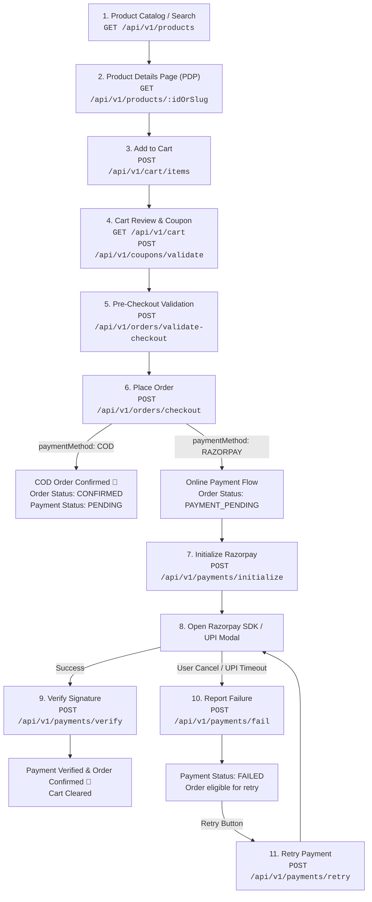

# 🛍️ Customer Journey API Integration Guide: Product Visit to Checkout (Online & COD)

> **Audience:** Frontend Developers (Web / React / Next.js / Mobile App / Flutter / React Native)  
> **Base URL:** `http://localhost:5000/api/v1` (or your staging/production domain)  
> **Auth Type:** Bearer JWT (`Authorization: Bearer <ACCESS_TOKEN>`)  
> **Payload Format:** `application/json`

---

## 📌 High-Level Flow Diagram



---

## 🔑 Global Headers & Conventions

All customer-facing requests should include the following headers:

| Header | Required? | Description |
| :--- | :--- | :--- |
| `Content-Type` | **Yes** | `application/json` |
| `Authorization` | Required for Cart & Checkout | `Bearer <CUSTOMER_ACCESS_TOKEN>` |
| `Idempotency-Key` | **Recommended for Checkout** | Unique UUID v4 generated on frontend to prevent duplicate order placements on accidental double clicks or network lag. |

---

## Step 1: Browse Products (Listing & Search)

Fetch active products with filtering, search query, category, and pagination.

* **Endpoint:** `GET /api/v1/products`
* **Auth:** Public (No token required)
* **Query Parameters:**
  * `page` (number, default: 1)
  * `limit` (number, default: 20)
  * `search` (string, optional)
  * `categoryId` (UUID, optional)
  * `brandId` (UUID, optional)
  * `sortBy` (e.g. `createdAt`, `price`)
  * `sortOrder` (`asc` | `desc`)

### Response (200 OK):
```json
{
  "success": true,
  "data": [
    {
      "id": "6a9e145f-c2db-432a-bc91-ffae8b8f36a1",
      "name": "Classic Oversized Cotton Hoodie",
      "slug": "classic-oversized-cotton-hoodie",
      "description": "Premium 100% combed cotton hoodie.",
      "basePrice": 1499.00,
      "salePrice": 1299.00,
      "brand": { "id": "...", "name": "Meeo Apparel" },
      "category": { "id": "...", "name": "Hoodies" },
      "images": [
        { "url": "https://cdn.meeo.in/products/hoodie-front.jpg", "isPrimary": true }
      ]
    }
  ],
  "meta": {
    "page": 1,
    "limit": 20,
    "total": 45,
    "totalPages": 3
  }
}
```

---

## Step 2: Product Details Page (PDP)

Fetch full product details including variants (colors, sizes), inventory stock status, specifications, and image gallery.

* **Endpoint:** `GET /api/v1/products/:id` OR `GET /api/v1/products/slug/:slug`
* **Auth:** Public

### Response (200 OK):
```json
{
  "success": true,
  "data": {
    "id": "6a9e145f-c2db-432a-bc91-ffae8b8f36a1",
    "name": "Classic Oversized Cotton Hoodie",
    "slug": "classic-oversized-cotton-hoodie",
    "description": "Premium heavy cotton fleece.",
    "basePrice": 1499.00,
    "salePrice": 1299.00,
    "images": [
      { "id": "...", "url": "https://cdn.meeo.in/hoodie-black-1.jpg", "isPrimary": true },
      { "id": "...", "url": "https://cdn.meeo.in/hoodie-black-2.jpg", "isPrimary": false }
    ],
    "variants": [
      {
        "id": "v101-923f-402a-995b-hoodie-blk-m",
        "sku": "HOODIE-BLK-M",
        "name": "Black / M",
        "price": 1299.00,
        "stock": 15,
        "isAvailable": true,
        "attributes": [
          { "name": "Color", "value": "Jet Black" },
          { "name": "Size", "value": "M" }
        ]
      },
      {
        "id": "v102-923f-402a-995b-hoodie-blk-l",
        "sku": "HOODIE-BLK-L",
        "name": "Black / L",
        "price": 1299.00,
        "stock": 0,
        "isAvailable": false,
        "attributes": [
          { "name": "Color", "value": "Jet Black" },
          { "name": "Size", "value": "L" }
        ]
      }
    ]
  }
}
```
> **Frontend Tip:** `variant.id` is the key ID required when adding items to the cart. If `stock === 0` or `!isAvailable`, disable the "Add to Cart" button.

---

## Step 3: Shopping Cart Operations

### 3.1 Add Item to Cart
* **Endpoint:** `POST /api/v1/cart/items`
* **Auth:** Required (`Bearer <ACCESS_TOKEN>`)

#### Request Body:
```json
{
  "variantId": "v101-923f-402a-995b-hoodie-blk-m",
  "quantity": 1
}
```

### 3.2 Fetch Current Cart
* **Endpoint:** `GET /api/v1/cart`
* **Auth:** Required

#### Response (200 OK):
```json
{
  "success": true,
  "data": {
    "id": "cart_883a-4f1b-90f7-123456789abc",
    "userId": "user_45a2-9988-...",
    "subtotal": 1299.00,
    "itemCount": 1,
    "items": [
      {
        "id": "item_301-229b-4401-...",
        "variantId": "v101-923f-402a-995b-hoodie-blk-m",
        "productName": "Classic Oversized Cotton Hoodie",
        "variantName": "Black / M",
        "unitPrice": 1299.00,
        "quantity": 1,
        "totalPrice": 1299.00,
        "imageUrl": "https://cdn.meeo.in/hoodie-black-1.jpg",
        "inStock": true,
        "availableStock": 15
      }
    ]
  }
}
```

### 3.3 Update Item Quantity / Remove
* **Update Quantity:** `PATCH /api/v1/cart/items/:itemId`  
  `Body: { "quantity": 2 }`
* **Remove Single Item:** `DELETE /api/v1/cart/items/:itemId`
* **Clear Cart:** `DELETE /api/v1/cart`

---

## Step 4: Apply Coupon & Manage Addresses

### 4.1 Validate Coupon Code
* **Endpoint:** `POST /api/v1/coupons/validate`
* **Auth:** Required

#### Request Body:
```json
{
  "code": "FIRST100",
  "cartSubtotal": 1299.00
}
```

#### Response (200 OK):
```json
{
  "success": true,
  "data": {
    "isValid": true,
    "discountAmount": 100.00,
    "coupon": {
      "code": "FIRST100",
      "type": "FIXED_AMOUNT",
      "discountValue": 100.00,
      "minOrderValue": 500.00
    }
  }
}
```

### 4.2 Fetch or Add Saved Shipping Address
* **Get Saved Addresses:** `GET /api/v1/user/addresses`
* **Add New Address:** `POST /api/v1/user/addresses`

#### Request Body:
```json
{
  "recipientName": "Rahul Kumar",
  "phone": "+919876543210",
  "addressLine1": "Flat 402, Sunshine Heights",
  "addressLine2": "Road No 12, Indiranagar",
  "city": "Bengaluru",
  "state": "Karnataka",
  "postalCode": "560038",
  "country": "India",
  "isDefault": true
}
```

---

## Step 5: Pre-Checkout Validation (Preview Bill Breakdown)

Call this before rendering the final order summary page. It validates live stock, recalculates delivery fee, tax/GST, and discounts.

* **Endpoint:** `POST /api/v1/orders/validate-checkout`
* **Auth:** Required

#### Request Body:
```json
{
  "shippingAddressId": "addr_921c-4b33-...",
  "paymentMethod": "RAZORPAY",
  "couponCode": "FIRST100"
}
```

#### Response (200 OK):
```json
{
  "success": true,
  "data": {
    "subtotal": 1299.00,
    "discountAmount": 100.00,
    "shippingFee": 40.00,
    "taxAmount": 0.00,
    "grandTotal": 1239.00,
    "currency": "INR",
    "canProceed": true,
    "items": [
      {
        "variantId": "v101-923f-402a-995b-hoodie-blk-m",
        "quantity": 1,
        "unitPrice": 1299.00,
        "isAvailable": true
      }
    ]
  }
}
```

---

## Step 6: Place Order (`POST /api/v1/orders/checkout`)

This is the transactional checkout endpoint. It atomically creates the order, reserves inventory stock, applies the coupon, and prepares the payment record.

* **Endpoint:** `POST /api/v1/orders/checkout`
* **Auth:** Required
* **Headers:**  
  `Idempotency-Key: <unique-uuid-v4>` (Prevents accidental duplicate orders)

#### Request Body:
```json
{
  "shippingAddressId": "addr_921c-4b33-...",
  "paymentMethod": "COD", 
  "couponCode": "FIRST100",
  "notes": "Please call before delivery"
}
```
*(Note: `paymentMethod` can be `"COD"` or `"RAZORPAY"`)*

---

## 🚚 Branch A: Cash on Delivery (COD) Flow

If the customer selected `"paymentMethod": "COD"`, the checkout response is immediately confirmed!

### Response from `POST /api/v1/orders/checkout` (COD):
```json
{
  "success": true,
  "message": "Order created successfully",
  "data": {
    "order": {
      "id": "ord_7e3b1c82-3d71-4235-8664-901b0451a441",
      "orderNumber": "MEEO-20261020-0081",
      "status": "CONFIRMED",
      "grandTotal": 1239.00,
      "currency": "INR",
      "paymentMethod": "COD"
    },
    "payment": {
      "id": "pay_3fa85f64-5717-4562-b3fc-2c963f66afa6",
      "status": "PENDING",
      "paidAmount": "0.00",
      "provider": "COD"
    }
  }
}
```

### Frontend Action for COD:
1. Clear local cart state.
2. Redirect customer directly to **Order Confirmation Screen** (`/order-success?orderId=ord_7e3b1c82-...`).
3. Display:
   * **Order Status:** `Confirmed`
   * **Payment Status:** `Cash to be collected upon delivery (₹1,239.00)`

---

## 💳 Branch B: Online Payment Flow (Razorpay / UPI / Cards)

If the customer selected `"paymentMethod": "RAZORPAY"`, the order is created in `PAYMENT_PENDING` status. Now initiate the gateway session.

### Step 7.1: Initialize Payment Intent
* **Endpoint:** `POST /api/v1/payments/initialize`
* **Auth:** Required

#### Request Body:
```json
{
  "orderId": "ord_7e3b1c82-3d71-4235-8664-901b0451a441"
}
```

#### Response (200 OK):
```json
{
  "success": true,
  "data": {
    "paymentId": "pay_3fa85f64-5717-4562-b3fc-2c963f66afa6",
    "provider": "RAZORPAY",
    "providerOrderId": "order_Pkx78aHjKl21",
    "amount": 1239.00,
    "currency": "INR",
    "keyId": "rzp_test_YourKeyHere",
    "customer": {
      "name": "Rahul Kumar",
      "email": "customer@example.com",
      "phone": "+919876543210"
    }
  }
}
```

---

### Step 7.2: Launch Razorpay Modal in Frontend

Install Razorpay checkout script in web (`https://checkout.razorpay.com/v1/checkout.js`) or use native mobile SDK.

```typescript
const options = {
  key: data.keyId,
  amount: data.amount * 100, // amount in paise
  currency: data.currency,
  name: "Meeo Store",
  description: `Order #${order.orderNumber}`,
  order_id: data.providerOrderId,
  prefill: {
    name: data.customer.name,
    email: data.customer.email,
    contact: data.customer.phone,
  },
  theme: {
    color: "#000000",
  },
  handler: async function (response: {
    razorpay_payment_id: string;
    razorpay_order_id: string;
    razorpay_signature: string;
  }) {
    // 🟢 SUCCESS: Call Verification API (Step 7.3)
    await verifyPayment(response);
  },
};

const rzp = new (window as any).Razorpay(options);

rzp.on("payment.failed", async function (response: any) {
  // 🔴 FAILURE: Call Fail API (Step 7.4)
  await reportPaymentFailure({
    orderId: order.id,
    failureCode: response.error.code,
    failureMessage: response.error.description,
    providerPaymentId: response.error.metadata?.payment_id,
  });
});

rzp.open();
```

---

### Step 7.3: Verify Payment Signature (On Gateway Success)
Jab customer UPI ya card se pay kar deta hai, Razorpay client SDK `handler` function trigger karta hai.

* **Endpoint:** `POST /api/v1/payments/verify`
* **Auth:** Required

#### Request Body:
```json
{
  "razorpayOrderId": "order_Pkx78aHjKl21",
  "razorpayPaymentId": "pay_Q8s7A19hKz",
  "razorpaySignature": "48b6c0e816a7f805a8d9a42167d3e098492..."
}
```

#### Response (200 OK):
```json
{
  "success": true,
  "data": {
    "verified": true,
    "paymentId": "pay_3fa85f64-5717-4562-b3fc-2c963f66afa6",
    "orderId": "ord_7e3b1c82-3d71-4235-8664-901b0451a441",
    "status": "SUCCESS",
    "message": "Payment verified and order confirmed successfully"
  }
}
```
* **Frontend Action:** Redirect to `/order-success?orderId=ord_7e3b1c82-...`. Cart is automatically cleared in database.

---

### Step 7.4: Handle Payment Cancellation / Failure (UPI Cancel or Timeout)
Jab user UPI intent cancel karta hai, bank server reject karta hai, ya modal close karta hai:

* **Endpoint:** `POST /api/v1/payments/fail`
* **Auth:** Required

#### Request Body:
```json
{
  "orderId": "ord_7e3b1c82-3d71-4235-8664-901b0451a441",
  "failureCode": "BAD_REQUEST_ERROR",
  "failureMessage": "Payment cancelled by user in UPI app",
  "providerPaymentId": "pay_failed_attempt_123"
}
```

#### Response (200 OK):
```json
{
  "success": true,
  "data": {
    "recorded": true,
    "paymentId": "pay_3fa85f64-5717-4562-b3fc-2c963f66afa6",
    "orderId": "ord_7e3b1c82-3d71-4235-8664-901b0451a441",
    "status": "FAILED",
    "message": "Payment failure recorded. Order is eligible for payment retry."
  }
}
```
* **Frontend Action:** Show UI message: **"Payment Failed or Cancelled. You can retry payment without losing your order."** Display a **"Retry Payment"** button.

---

### Step 7.5: Retry Failed Payment
Jab customer failed order par "Retry Payment" par click karta hai:

* **Endpoint:** `POST /api/v1/payments/retry`
* **Auth:** Required

#### Request Body:
```json
{
  "paymentId": "pay_3fa85f64-5717-4562-b3fc-2c963f66afa6"
}
```

#### Response (200 OK):
```json
{
  "success": true,
  "data": {
    "paymentId": "pay_3fa85f64-5717-4562-b3fc-2c963f66afa6",
    "providerOrderId": "order_NewAttempt_8819",
    "amount": 1239.00,
    "currency": "INR",
    "keyId": "rzp_test_YourKeyHere",
    "attemptNumber": 2
  }
}
```
* **Frontend Action:** Re-open Razorpay checkout modal using the new `providerOrderId`.

---

## Step 8: Customer Order Details & Tracking

Customer order history aur tracking status dekhne ke liye:

* **Endpoint:** `GET /api/v1/orders/:id`
* **Auth:** Required

### Response (200 OK):
```json
{
  "success": true,
  "data": {
    "id": "ord_7e3b1c82-3d71-4235-8664-901b0451a441",
    "orderNumber": "MEEO-20261020-0081",
    "status": "CONFIRMED",
    "grandTotal": 1239.00,
    "currency": "INR",
    "paymentMethod": "COD",
    "payment": {
      "status": "PENDING",
      "paidAmount": "0.00"
    },
    "items": [
      {
        "id": "...",
        "productName": "Classic Oversized Cotton Hoodie",
        "variantName": "Black / M",
        "quantity": 1,
        "unitPrice": 1299.00
      }
    ],
    "shippingAddress": {
      "recipientName": "Rahul Kumar",
      "phone": "+919876543210",
      "addressLine1": "Flat 402, Sunshine Heights",
      "city": "Bengaluru",
      "postalCode": "560038"
    },
    "statusHistory": [
      {
        "status": "CONFIRMED",
        "createdAt": "2026-10-20T10:45:00.000Z"
      }
    ]
  }
}
```

---

## 📦 Copy-Paste TypeScript Interfaces for Frontend

```typescript
// --- Product & Cart ---
export interface ProductVariant {
  id: string;
  sku: string;
  name: string;
  price: number;
  stock: number;
  isAvailable: boolean;
  attributes: Array<{ name: string; value: string }>;
}

export interface CartItem {
  id: string;
  variantId: string;
  productName: string;
  variantName: string;
  unitPrice: number;
  quantity: number;
  totalPrice: number;
  imageUrl?: string;
  inStock: boolean;
  availableStock: number;
}

// --- Checkout ---
export interface CheckoutPayload {
  shippingAddressId: string;
  billingAddressId?: string;
  paymentMethod: "COD" | "RAZORPAY";
  couponCode?: string;
  notes?: string;
}

export interface CheckoutValidationResponse {
  subtotal: number;
  discountAmount: number;
  shippingFee: number;
  taxAmount: number;
  grandTotal: number;
  currency: string;
  canProceed: boolean;
}

// --- Payment ---
export interface InitializePaymentResponse {
  paymentId: string;
  provider: "RAZORPAY" | "COD";
  providerOrderId?: string;
  amount: number;
  currency: string;
  keyId?: string;
  customer?: {
    name: string;
    email: string;
    phone: string;
  };
}

export interface VerifyPaymentPayload {
  razorpayOrderId: string;
  razorpayPaymentId: string;
  razorpaySignature: string;
}

export interface RecordPaymentFailurePayload {
  orderId: string;
  failureCode?: string;
  failureMessage?: string;
  providerPaymentId?: string;
}
```
