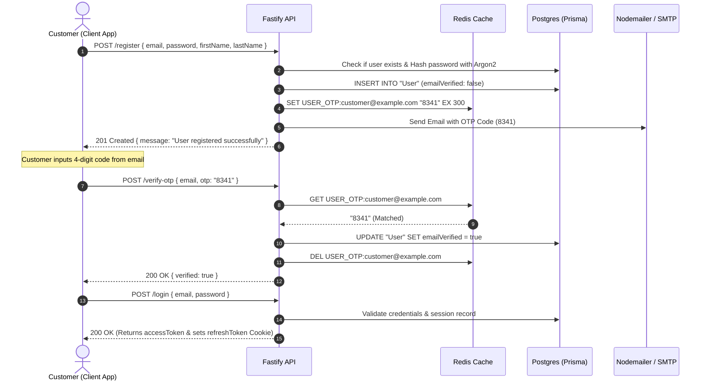
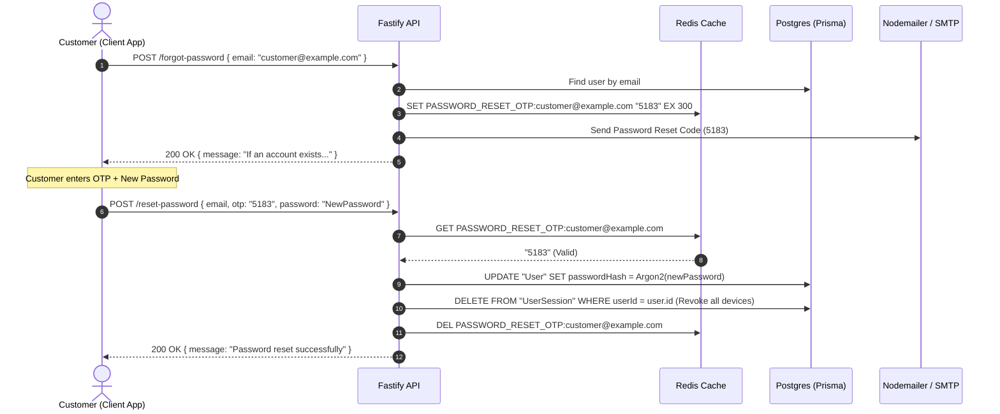
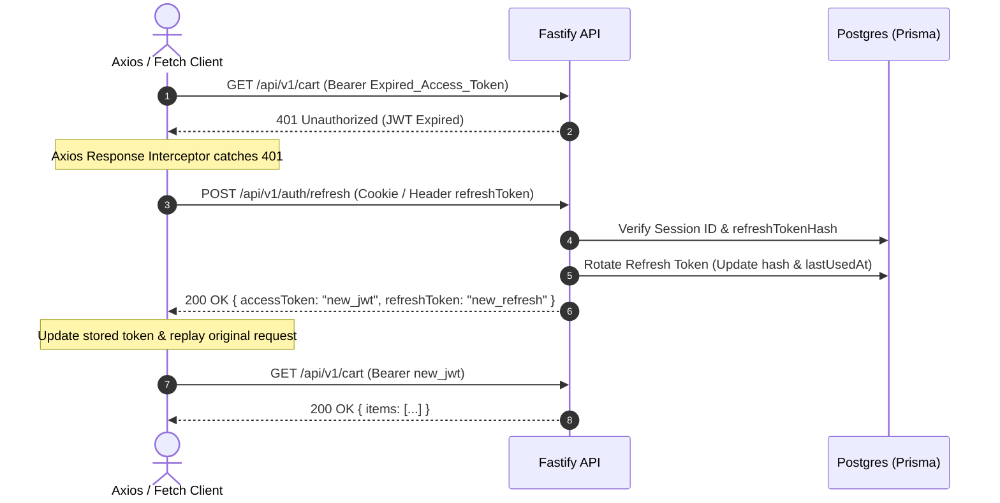

# 🔐 Customer Authentication & Lifecycle Documentation

This document serves as the complete engineering reference for the **Customer Authentication & Session Management System** across Web (Next.js) and Mobile (React Native / Expo) applications.

---

## 📑 Table of Contents

1. [Architecture & Token Strategy](#1-architecture--token-strategy)
2. [API Endpoints Reference](#2-api-endpoints-reference)
   - [2.1 User Registration (`POST /register`)](#21-user-registration)
   - [2.2 Verify Registration OTP (`POST /verify-otp`)](#22-verify-registration-otp)
   - [2.3 Resend Verification OTP (`POST /resend-otp`)](#23-resend-verification-otp)
   - [2.4 Customer Login (`POST /login`)](#24-customer-login)
   - [2.5 Google OAuth Login (`POST /google`)](#25-google-oauth-login)
   - [2.6 Forgot Password OTP (`POST /forgot-password`)](#26-forgot-password-otp)
   - [2.7 Reset Password (`POST /reset-password`)](#27-reset-password)
   - [2.8 Token Refresh (`POST /refresh`)](#28-token-refresh)
   - [2.9 Get Current User Profile (`GET /me`)](#29-get-current-user-profile)
   - [2.10 Logout (`POST /logout`) & Session Revocation](#210-logout--session-revocation)
3. [Authentication Flows & Sequence Diagrams](#3-authentication-flows--sequence-diagrams)
   - [Flow A: Registration & OTP Verification](#flow-a-registration--otp-verification)
   - [Flow B: Forgot Password & Reset](#flow-b-forgot-password--reset)
   - [Flow C: Silent Token Refresh Interceptor](#flow-c-silent-token-refresh-interceptor)
4. [Edge Cases & Error Handling Matrix](#4-edge-cases--error-handling-matrix)
5. [Client Storage & Integration Guidelines](#5-client-storage--integration-guidelines)

---

## 1. Architecture & Token Strategy

The system utilizes a dual-token authentication mechanism backed by **JWT**, **Redis**, and **PostgreSQL / Prisma**:

| Component | Lifespan | Storage (Web) | Storage (Mobile / Expo) | Purpose |
| :--- | :--- | :--- | :--- | :--- |
| **Access Token** | 5 – 15 Minutes | In-Memory / HttpOnly Cookie | `expo-secure-store` / Memory | Short-lived token sent as `Authorization: Bearer <token>` to authenticate API calls. |
| **Refresh Token** | 7 Days | `HttpOnly`, `SameSite=Lax`, `Secure` Cookie | `expo-secure-store` | Long-lived token used solely to issue a new Access Token. Rotates on each use. |
| **Verification OTP** | 5 Minutes (300s) | Redis (`USER_OTP:<email>`) | Temporary User Input | 4-digit numeric code required to verify email ownership. |
| **Password Reset OTP**| 5 Minutes (300s) | Redis (`PASSWORD_RESET_OTP:<email>`) | Temporary User Input | 4-digit numeric code required to authorize password changes. |

---

## 2. API Endpoints Reference

> **Base URL:** `http://<server-ip>:5000/api/v1/auth`

---

### 2.1 User Registration

Registers a new customer account, hashes password with **Argon2**, creates an unverified user record, generates a 4-digit OTP in Redis (5-min TTL), and dispatches a verification email.

- **Method:** `POST`
- **Path:** `/api/v1/auth/register`
- **Access:** Public

#### Request Body
```json
{
  "firstName": "Rahul",
  "lastName": "Kumar",
  "email": "customer@example.com",
  "password": "StrongPassword@123"
}
```

#### Validation Rules
- `firstName`: Required, string, min length 1.
- `lastName`: Required, string, min length 1.
- `email`: Required, valid email format.
- `password`: Required, string, min 5 characters, max 100 characters.

#### Response `201 Created`
```json
{
  "success": true,
  "message": "User registered successfully",
  "data": {
    "user": {
      "id": "usr_c812d3ef-4b21-4d1a-b620-802c375628b3",
      "firstName": "Rahul",
      "lastName": "Kumar",
      "email": "customer@example.com",
      "createdAt": "2026-09-24T10:30:00.000Z",
      "updatedAt": "2026-09-24T10:30:00.000Z"
    },
    "tempOtp": "8341"
  }
}
```
*(Note: `tempOtp` is returned in non-production environments for automated testing/debugging).*

---

### 2.2 Verify Registration OTP

Validates the 4-digit OTP against Redis and marks `emailVerified: true` in the database.

- **Method:** `POST`
- **Path:** `/api/v1/auth/verify-otp`
- **Access:** Public

#### Request Body
```json
{
  "email": "customer@example.com",
  "otp": "8341"
}
```

#### Validation Rules
- `email`: Required, valid email.
- `otp`: Required, string or numeric coercion matching regex `^\d{4}$`.

#### Response `200 OK`
```json
{
  "success": true,
  "message": "Email verified successfully",
  "data": {
    "verified": true
  }
}
```

---

### 2.3 Resend Verification OTP

Generates a fresh 4-digit OTP, updates Redis TTL to 5 minutes, and resends the verification email.

- **Method:** `POST`
- **Path:** `/api/v1/auth/resend-otp`
- **Access:** Public

#### Request Body
```json
{
  "email": "customer@example.com"
}
```

#### Response `200 OK`
```json
{
  "success": true,
  "message": "If the account requires verification, a new OTP has been sent",
  "data": {
    "tempOtp": "4920"
  }
}
```
*(Returns an empty data object `{}` if user does not exist or is already verified to prevent account enumeration).*

---

### 2.4 Customer Login

Authenticates user credentials, verifies that email is verified and account is active, registers an active device session in `userSession`, sets `HttpOnly` cookies, and returns tokens.

- **Method:** `POST`
- **Path:** `/api/v1/auth/login`
- **Access:** Public

#### Request Body
```json
{
  "email": "customer@example.com",
  "password": "StrongPassword@123",
  "deviceName": "iPhone 15 Pro",
  "deviceId": "c89b21f0-128a-4f51-b0e2"
}
```

#### Response `200 OK`
**Headers:**
- `Set-Cookie`: `refreshToken=...; HttpOnly; Path=/api/v1/auth; Max-Age=604800; SameSite=Lax; Secure`
- `Set-Cookie`: `accessToken=...; HttpOnly; Path=/; Max-Age=900; SameSite=Lax; Secure`

```json
{
  "success": true,
  "message": "Login successful",
  "data": {
    "user": {
      "id": "usr_c812d3ef-4b21-4d1a-b620-802c375628b3",
      "firstName": "Rahul",
      "lastName": "Kumar",
      "email": "customer@example.com"
    },
    "accessToken": "eyJhbGciOiJIUzI1NiIsInR5cCI6IkpXVCJ9.eyJ1c2VySWQiOiJ1c3JfYzgxMmQzZWYtNGIyMS00ZDFhLWI2MjAtODAyYzM3NTYyOGIzIiwiZW1haWwiOiJjdXN0b21lckBleGFtcGxlLmNvbSIsInNlc3Npb25JZCI6IjhkYmMzZjM4LTQxNGUtNGIyYy04Y2Y4LWQyMTY1NGFjMzkzZSIsImlhdCI6MTc5MDI0OTgwMCwiZXhwIjoxNzkwMjUwNzAwfQ...",
    "refreshToken": "eyJhbGciOiJIUzI1NiIsInR5cCI6IkpXVCJ9.eyJ1c2VySWQiOiJ1c3JfYzgxMmQzZWYtNGIyMS00ZDFhLWI2MjAtODAyYzM3NTYyOGIzIiwiZW1haWwiOiJjdXN0b21lckBleGFtcGxlLmNvbSIsInNlc3Npb25JZCI6IjhkYmMzZjM4LTQxNGUtNGIyYy04Y2Y4LWQyMTY1NGFjMzkzZSIsImlhdCI6MTc5MDI0OTgwMCwiZXhwIjoxNzkwODU0NjAwfQ..."
  }
}
```

---

### 2.5 Google OAuth Login

Verifies Google ID Token (issued by Google Sign-In on Web or React Native / Expo), links or creates user account, marks email as verified, and creates session.

- **Method:** `POST`
- **Path:** `/api/v1/auth/google`
- **Access:** Public

#### Request Body
```json
{
  "idToken": "eyJhbGciOiJSUzI1NiIsImtpZCI6ImRiZjQ0YmY0NTQ...",
  "deviceName": "Pixel 8",
  "deviceId": "91a82f3c-8a42-4911-8e9a"
}
```

#### Response `200 OK`
```json
{
  "success": true,
  "message": "Google authentication successful",
  "data": {
    "user": {
      "id": "usr_c812d3ef-4b21-4d1a-b620-802c375628b3",
      "firstName": "Rahul",
      "lastName": "Kumar",
      "email": "customer@example.com"
    },
    "accessToken": "eyJhbGciOiJIUzI1NiIsInR5cCI6IkpXVCJ9...",
    "refreshToken": "eyJhbGciOiJIUzI1NiIsInR5cCI6IkpXVCJ9..."
  }
}
```

---

### 2.6 Forgot Password OTP

Dispatches a 4-digit password reset verification code to the customer's registered email.

- **Method:** `POST`
- **Path:** `/api/v1/auth/forgot-password`
- **Access:** Public

#### Request Body
```json
{
  "email": "customer@example.com"
}
```

#### Response `200 OK`
```json
{
  "success": true,
  "message": "If an account exists, password reset instructions have been sent",
  "data": {
    "tempOtp": "5183"
  }
}
```

---

### 2.7 Reset Password

Verifies the password reset OTP from Redis, hashes the new password with Argon2, updates the user record, and **invalidates all active user sessions** across all devices.

- **Method:** `POST`
- **Path:** `/api/v1/auth/reset-password`
- **Access:** Public

#### Request Body
```json
{
  "email": "customer@example.com",
  "otp": "5183",
  "password": "NewStrongPassword@2026"
}
```

#### Response `200 OK`
```json
{
  "success": true,
  "message": "Password reset successfully"
}
```

---

### 2.8 Token Refresh

Rotates the refresh token and returns a fresh short-lived `accessToken`.

- **Method:** `POST`
- **Path:** `/api/v1/auth/refresh`
- **Access:** Public (Reads token from HttpOnly cookie `refreshToken`, request body `{ "refreshToken": "..." }`, or header `x-refresh-token`)

#### Request Body *(Optional if cookie is present)*
```json
{
  "refreshToken": "eyJhbGciOiJIUzI1NiIsInR5cCI6IkpXVCJ9..."
}
```

#### Response `200 OK`
```json
{
  "success": true,
  "message": "Token refreshed successfully",
  "data": {
    "accessToken": "eyJhbGciOiJIUzI1NiIsInR5cCI6IkpXVCJ9.new_access_token...",
    "refreshToken": "eyJhbGciOiJIUzI1NiIsInR5cCI6IkpXVCJ9.new_rotated_refresh_token..."
  }
}
```

---

### 2.9 Get Current User Profile

Fetches authenticated user profile, verified status, and roles from cache or database.

- **Method:** `GET`
- **Path:** `/api/v1/auth/me`
- **Access:** Authenticated (`Authorization: Bearer <accessToken>`)

#### Response `200 OK`
```json
{
  "success": true,
  "message": "Current user fetched successfully",
  "data": {
    "id": "usr_c812d3ef-4b21-4d1a-b620-802c375628b3",
    "firstName": "Rahul",
    "lastName": "Kumar",
    "email": "customer@example.com",
    "phone": "+919876543210",
    "avatarUrl": "https://res.cloudinary.com/meeo/avatars/user-1.jpg",
    "emailVerified": true,
    "phoneVerified": true,
    "status": "ACTIVE",
    "roles": ["CUSTOMER"],
    "createdAt": "2026-09-24T10:30:00.000Z",
    "updatedAt": "2026-09-24T11:00:00.000Z"
  }
}
```

---

### 2.10 Logout & Session Revocation

- **`POST /api/v1/auth/logout`**: Revokes current active session in database, evicts Redis auth cache, and clears cookies.
- **`POST /api/v1/auth/logout-all`**: Revokes all active sessions for the user across every device.
- **`GET /api/v1/auth/sessions`**: Lists all active client sessions (device name, IP, user-agent, last active timestamp).
- **`DELETE /api/v1/auth/sessions/:sessionId`**: Revokes a specific remote device session.

---

## 3. Authentication Flows & Sequence Diagrams

### Flow A: Registration & OTP Verification



---

### Flow B: Forgot Password & Reset



---

### Flow C: Silent Token Refresh Interceptor



---

## 4. Edge Cases & Error Handling Matrix

| Scenario | Trigger / Condition | HTTP Code | Error Response Message | Client Action |
| :--- | :--- | :--- | :--- | :--- |
| **Duplicate Registration** | Email already exists in DB | `409 Conflict` | `"User with this email already exists"` | Prompt user to login or request password reset. |
| **Weak Password** | Password length < 5 characters | `400 Bad Request` | `"Password must be at least 5 characters"` | Display inline validation error on form. |
| **Invalid OTP Format** | OTP string length != 4 or non-numeric | `400 Bad Request` | `"OTP must be exactly 4 digits"` | Restrict input to 4 digits in client pin-field. |
| **Expired / Wrong OTP** | Redis key expired (> 5 min) or mismatch | `400 Bad Request` | `"OTP is invalid or expired"` | Show error message with "Resend OTP" button. |
| **Unverified Login** | Valid password but `emailVerified == false` | `403 Forbidden` | `"Please verify your email before logging in"` | Redirect user to `/verify-otp` screen. |
| **Banned / Blocked Account**| User `status != ACTIVE` (e.g. `SUSPENDED`) | `403 Forbidden` | `"Account is suspended"` | Display support contact information. |
| **Invalid Credentials** | Wrong email or wrong password | `401 Unauthorized` | `"Invalid email or password"` | Show generic bad credentials notification. |
| **Access Token Expired** | Expired JWT timestamp | `401 Unauthorized` | `"jwt expired"` / `"Unauthorized"` | Trigger silent token refresh via `/refresh`. |
| **Revoked Session / Reuse**| Refresh token already rotated or session revoked | `401 Unauthorized` | `"Refresh token is invalid"` / `"Session expired"` | Clear all stored tokens and redirect to `/login`. |
| **Password Reset Invalidation**| Password was reset on another device | `401 Unauthorized` | `"Session revoked"` | Force re-login with the new password. |
| **Rate Limit / Spamming** | > 5 OTP requests in rapid succession | `429 Too Many Requests` | `"Too many requests, please try again later"` | Disable submit button with a 60-second cooldown timer. |

---

## 5. Client Storage & Integration Guidelines

### React Native / Expo (`expo-secure-store`)

```typescript
import * as SecureStore from 'expo-secure-store';
import axios from 'axios';

const API_BASE_URL = 'http://10.93.5.170:5000/api/v1';

export const apiClient = axios.create({
  baseURL: API_BASE_URL,
  headers: {
    'Content-Type': 'application/json',
  },
});

// 1. Attach Access Token to all outgoing requests
apiClient.interceptors.request.use(async (config) => {
  const token = await SecureStore.getItemAsync('accessToken');
  if (token) {
    config.headers.Authorization = `Bearer ${token}`;
  }
  return config;
});

// 2. Handle 401 Unauthorized & Silent Token Refresh
let isRefreshing = false;
let failedQueue: Array<{ resolve: (token: string) => void; reject: (err: any) => void }> = [];

const processQueue = (error: any, token: string | null = null) => {
  failedQueue.forEach((prom) => {
    if (error) {
      prom.reject(error);
    } else {
      prom.resolve(token!);
    }
  });
  failedQueue = [];
};

apiClient.interceptors.response.use(
  (response) => response,
  async (error) => {
    const originalRequest = error.config;

    if (error.response?.status === 401 && !originalRequest._retry) {
      if (isRefreshing) {
        return new Promise((resolve, reject) => {
          failedQueue.push({ resolve, reject });
        })
          .then((token) => {
            originalRequest.headers.Authorization = `Bearer ${token}`;
            return apiClient(originalRequest);
          })
          .catch((err) => Promise.reject(err));
      }

      originalRequest._retry = true;
      isRefreshing = true;

      try {
        const storedRefreshToken = await SecureStore.getItemAsync('refreshToken');
        if (!storedRefreshToken) throw new Error('No refresh token available');

        const { data } = await axios.post(`${API_BASE_URL}/auth/refresh`, {
          refreshToken: storedRefreshToken,
        });

        const newAccessToken = data.data.accessToken;
        const newRefreshToken = data.data.refreshToken;

        await SecureStore.setItemAsync('accessToken', newAccessToken);
        if (newRefreshToken) {
          await SecureStore.setItemAsync('refreshToken', newRefreshToken);
        }

        processQueue(null, newAccessToken);
        originalRequest.headers.Authorization = `Bearer ${newAccessToken}`;
        return apiClient(originalRequest);
      } catch (refreshErr) {
        processQueue(refreshErr, null);
        await SecureStore.deleteItemAsync('accessToken');
        await SecureStore.deleteItemAsync('refreshToken');
        // Navigate user to login screen
        return Promise.reject(refreshErr);
      } finally {
        isRefreshing = false;
      }
    }

    return Promise.reject(error);
  }
);
```
