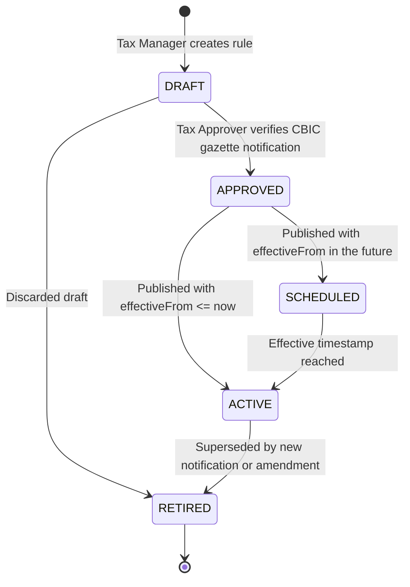

# Meeo GST Tax Engine — Administrator Operational Guide

This operational guide instructs Meeo compliance officers, financial controllers, and administrators on managing the statutory tax rule catalog, verifying government gazette notifications, conducting dual-authorization approvals, and tracking audit history.

---

## 1. Compliance Responsibilities & Role-Based Access Control (RBAC)

The Meeo GST Engine enforces separation of duty to prevent erroneous or unauthorized tax modifications:

| Role / Permission | Responsibilities | Permitted Actions |
|---|---|---|
| **Tax Auditor** (`TAX_READ`) | Reviews rule configurations, inspections, audit trails | `GET /api/v1/tax/rules`, `GET /api/v1/tax/classifications`, `GET /api/v1/tax/rules/:id/audits` |
| **Tax Manager** (`TAX_MANAGE`) | Drafts new rules, creates HSN entries, publishes approved rules, retires rules | `POST /api/v1/tax/rules`, `POST /api/v1/tax/classifications`, `PATCH /rules/:id/publish`, `PATCH /rules/:id/retire` |
| **Tax Approver / Counsel** (`TAX_APPROVE`) | Independent legal verification of official gazette notification, verifies HSN classification | `PATCH /api/v1/tax/rules/:id/approve`, `PATCH /api/v1/tax/classifications/:id/status` |

---

## 2. Standard Tax Rule Lifecycle



---

## 3. Step-by-Step Administrative Workflows

### Step 1: Verify Government Gazette Notification
1. Access the official Central Board of Indirect Taxes and Customs (CBIC) portal (`cbic.gov.in`).
2. Verify the notification number (e.g. `Notification No. 04/2026-Central Tax (Rate)`), effective date, and exact 4/6/8-digit HSN code schedule.
3. Record the notification reference and official date.

### Step 2: Create or Verify Tax Classification
1. Check if the HSN/SAC code exists:
   ```bash
   curl -H "Authorization: Bearer <TOKEN>" \
        "https://api.meeo.com/api/v1/tax/classifications?search=8471"
   ```
2. If absent, create a new classification entry with `TAX_MANAGE` permission:
   ```json
   POST /api/v1/tax/classifications
   {
     "hsnCode": "84713010",
     "description": "Laptops and portable digital processing machines",
     "category": "Electronics"
   }
   ```
3. A user with `TAX_APPROVE` marks the classification as `VERIFIED`:
   ```json
   PATCH /api/v1/tax/classifications/:id/status
   {
     "status": "VERIFIED"
   }
   ```

### Step 3: Create a DRAFT Tax Rule
1. Submit the draft rule payload:
   ```json
   POST /api/v1/tax/rules
   {
     "hsnCode": "84713010",
     "taxTreatment": "TAXABLE",
     "cgstRate": 9.0,
     "sgstRate": 9.0,
     "igstRate": 18.0,
     "effectiveFrom": "2026-11-01T00:00:00.000Z",
     "notificationRef": "CBIC Notif No. 04/2026-Central Tax (Rate)"
   }
   ```
2. The rule is created with status `DRAFT` and version `1`.

### Step 4: Independent Approval
1. An authorized approver reviews the draft against the official gazette.
2. If compliant, they submit the approval:
   ```json
   PATCH /api/v1/tax/rules/:id/approve
   {
     "reason": "Verified against official CBIC notification dated 15 Oct 2026"
   }
   ```

### Step 5: Publish or Schedule
1. Publish the approved rule:
   ```json
   PATCH /api/v1/tax/rules/:id/publish
   ```
2. If `effectiveFrom` is in the future, the rule status transitions to `SCHEDULED`.
3. If `effectiveFrom <= now`, the rule activates immediately (`ACTIVE`), and any existing active rule for the same HSN is safely bound and retired.

---

## 4. Recovering from Mistakes & Rollbacks

1. **Rule Overlap Conflict**: If two rules conflict for the same HSN, the checkout engine fails safe and throws a `409 Conflict` rather than guessing a rate. To fix, retire the erroneous rule immediately via `PATCH /api/v1/tax/rules/:id/retire`.
2. **Never Delete Historical Rules**: Deleting rules breaks relational integrity and auditability. Always use `RETIRED` status.
3. **Auditing Incident History**: Inspect the immutable audit log:
   ```bash
   GET /api/v1/tax/rules/:id/audits
   ```
   This displays every actor ID, timestamp, before/after diffs, and justifications.

---

## 5. GST Rule-Change Runbook (Standard Operating Procedure)

Follow this standard operating procedure whenever the CBIC or GST Council announces a statutory tax rate amendment:

### Phase A: Ingestion & Impact Analysis (T - 5 Days)
1. **Gazette Download**: Retrieve official notification PDF directly from `cbic.gov.in`.
2. **Catalog Query**: Identify affected products in the Meeo catalog:
   ```sql
   SELECT p.id, p.name, p."hsnCode", tc.id AS classification_id
   FROM products p
   LEFT JOIN tax_classifications tc ON p."taxClassificationId" = tc.id OR p."hsnCode" = tc."hsnCode"
   WHERE p."hsnCode" LIKE '8471%';
   ```
3. **Draft Rule Entry**: A compliance manager submits a `DRAFT` rule with `effectiveFrom` set to the legal midnight commencement date (e.g., `2026-11-01T00:00:00.000Z`).

### Phase B: Dual Approval & Pre-Scheduling (T - 2 Days)
1. **Independent Verification**: A second officer with `TAX_APPROVE` validates the CBIC notification reference and approves the draft.
2. **Schedule Publication**: Call `PATCH /api/v1/tax/rules/:id/publish`. The engine automatically transitions the status to `SCHEDULED`.
3. **Smoke Verification**: Verify that existing checkouts continue using the current rate, and query future test quotes to verify scheduled readiness.

### Phase C: Activation & Post-Commencement Audit (T + 1 Hour)
1. At the effective timestamp, the engine seamlessly selects the new active rule for incoming checkouts.
2. Verify production order placement:
   ```sql
   SELECT id, "orderId", "placeOfSupplyStateCode", "totalTaxableAmount", "totalTaxAmount", "shippingGstRate", "createdAt"
   FROM order_tax_snapshots
   ORDER BY "createdAt" DESC
   LIMIT 5;
   ```
3. Check application logs for any `409 TAX_CONFLICT` exceptions or unclassified catalog warnings.

---

## 6. Tax Reconciliation & Production Incident Procedures

### 6.1 Monthly GSTR-1 & GSTR-8 Reconciliation
At month-end, run reconciliation against generated order tax snapshots:
```sql
-- Monthly B2C & B2B Tax Aggregation for GSTR-1
SELECT 
    "placeOfSupplyStateCode",
    "isInterState",
    COUNT(*) AS total_orders,
    SUM("totalTaxableAmount") AS total_taxable_value,
    SUM("totalCgstAmount") AS total_cgst,
    SUM("totalSgstAmount") AS total_sgst,
    SUM("totalIgstAmount") AS total_igst,
    SUM("totalTaxAmount") AS total_tax
FROM order_tax_snapshots
WHERE "createdAt" >= '2026-10-01' AND "createdAt" < '2026-11-01'
GROUP BY "placeOfSupplyStateCode", "isInterState"
ORDER BY "placeOfSupplyStateCode";
```

### 6.2 Incident: Discrepancy Between Payment Gateway and Order Tax Snapshot
- **Symptom**: Payment gateway captured amount differs from order total by $\pm ₹0.01$ or more.
- **Root Cause Check**: Verify if customer applied a coupon that was modified concurrently during payment redirection.
- **Remediation**:
  1. Inspect the immutable snapshot in `order_tax_snapshots`.
  2. Compare `OrderTaxSnapshot.totalTaxableAmount + totalTaxAmount + shippingTaxableAmount` against `Order.total`.
  3. If discrepancy was caused by payment provider rounding, the order creation service reconciles to the authoritative `OrderTaxSnapshot` payload.

### 6.3 Incident: Product Listed Without Verified Tax Classification
- **Symptom**: Warning logged: `[GST Engine] Product missing verified classification`.
- **Remediation**:
  1. Navigate to Admin Portal $\rightarrow$ Unverified Tax Classifications (`GET /api/v1/tax/classifications?verificationStatus=UNVERIFIED`).
  2. Assign verified 4/6/8-digit HSN code.
  3. Update status to `VERIFIED` via `PATCH /api/v1/tax/classifications/:id/status`. Subsequent checkouts immediately switch from fallback to the verified rate.

