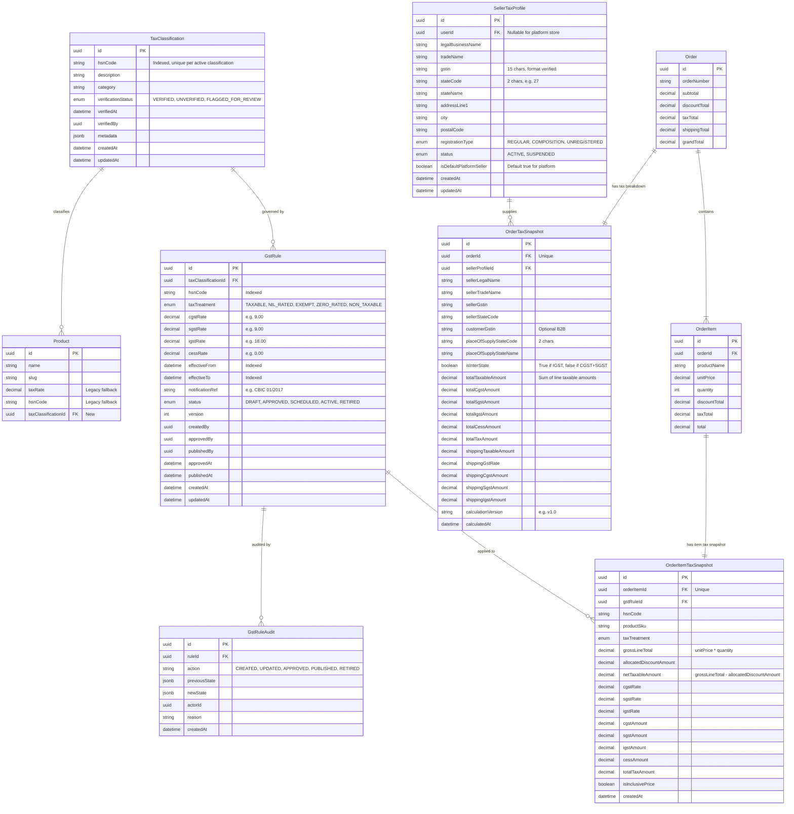

# Meeo E-Commerce GST Engine: Database Design Specification

> **Document Version**: 1.0.0  
> **Date**: October 2026  
> **Status**: Approved Architecture Specification  

---

## 1. Architectural Overview & Design Objectives

The Meeo GST Database Architecture provides:
1. **Statutory Integrity**: Strict separation of Product classification (HSN/SAC), Statutory Rate Rules (`GstRule`), Supplier Registration (`SellerTaxProfile`), and Immutable Order Snapshots (`OrderTaxSnapshot` & `OrderItemTaxSnapshot`).
2. **Effective Dating & Versioning**: Complete history of rule changes with `effectiveFrom`, `effectiveTo`, and version tracking, preventing retroactive alteration of historical tax data.
3. **Decimal Safety**: All tax rates, taxable amounts, and tax splits use PostgreSQL `DECIMAL(12, 2)` or `DECIMAL(5, 2)` to eliminate JavaScript floating-point errors.
4. **Auditability**: Dedicated audit trail (`GstRuleAudit`) logging every actor, approver, statutory notification reference, and diff.
5. **Backward Compatibility**: Non-destructive extension of the existing schema. Existing fields like `Product.taxRate` and `Order.taxTotal` continue to function as legacy fallbacks.

---

## 2. Mermaid Entity-Relationship (ER) Diagram

---

## 3. Data Models Specification

### 3.1 `TaxClassification`
Represents official HSN (Harmonized System of Nomenclature) or SAC (Services Accounting Code) product and service classifications under the Indian GST regime.
- **Table Name**: `tax_classifications`
- **Fields**:
  - `id`: `UUID` (Primary Key).
  - `hsnCode`: `VARCHAR(16)` (e.g., `8517`, `61091000`). Indexed.
  - `description`: `TEXT` (Statutory description of goods/services).
  - `category`: `VARCHAR(64)` (General category classification).
  - `verificationStatus`: `TaxVerificationStatus` enum (`VERIFIED`, `UNVERIFIED`, `FLAGGED_FOR_REVIEW`). Default `UNVERIFIED`.
  - `verifiedAt`: `TIMESTAMP(3)` nullable.
  - `verifiedById`: `UUID` nullable (References `User.id`).
  - `metadata`: `JSONB` nullable (Government circulars, chapter notes).
  - `createdAt`, `updatedAt`: `TIMESTAMP(3)`.
- **Indexes & Constraints**:
  - `UNIQUE (hsnCode)`
  - `INDEX (verificationStatus)`

### 3.2 `GstRule`
The statutory rate table defining tax treatment, rates, and effective date intervals.
- **Table Name**: `gst_rules`
- **Fields**:
  - `id`: `UUID` (Primary Key).
  - `taxClassificationId`: `UUID` (Foreign key to `TaxClassification.id`).
  - `hsnCode`: `VARCHAR(16)` (Denormalized for fast rule lookups). Indexed.
  - `taxTreatment`: `GstTaxTreatment` enum (`TAXABLE`, `NIL_RATED`, `EXEMPT`, `ZERO_RATED`, `NON_TAXABLE`). Default `TAXABLE`.
  - `cgstRate`: `DECIMAL(5, 2)` (e.g., 9.00).
  - `sgstRate`: `DECIMAL(5, 2)` (e.g., 9.00).
  - `igstRate`: `DECIMAL(5, 2)` (e.g., 18.00).
  - `cessRate`: `DECIMAL(5, 2)` (e.g., 0.00). Default `0.00`.
  - `effectiveFrom`: `TIMESTAMP(3)`. Indexed.
  - `effectiveTo`: `TIMESTAMP(3)` nullable. Indexed.
  - `notificationRef`: `VARCHAR(255)` (e.g., "Notification No. 01/2017-Central Tax (Rate)").
  - `status`: `GstRuleStatus` enum (`DRAFT`, `APPROVED`, `SCHEDULED`, `ACTIVE`, `RETIRED`). Default `DRAFT`.
  - `version`: `INTEGER` (Starts at 1, increments on new statutory revisions).
  - `createdById`: `UUID` nullable.
  - `approvedById`: `UUID` nullable.
  - `publishedById`: `UUID` nullable.
  - `approvedAt`, `publishedAt`: `TIMESTAMP(3)` nullable.
  - `createdAt`, `updatedAt`: `TIMESTAMP(3)`.
- **Indexes & Constraints**:
  - `INDEX (hsnCode, status, effectiveFrom, effectiveTo)`
  - `INDEX (status, effectiveFrom)`

### 3.3 `GstRuleAudit`
Maintains an immutable ledger of all tax rule state transitions.
- **Table Name**: `gst_rule_audits`
- **Fields**:
  - `id`: `UUID` (Primary Key).
  - `ruleId`: `UUID` (References `GstRule.id`).
  - `action`: `VARCHAR(50)` (`RULE_CREATED`, `RULE_UPDATED`, `RULE_APPROVED`, `RULE_PUBLISHED`, `RULE_RETIRED`, `OVERRIDE_APPLIED`).
  - `previousState`: `JSONB` nullable.
  - `newState`: `JSONB`.
  - `actorId`: `UUID` nullable.
  - `reason`: `TEXT` nullable.
  - `notificationRef`: `VARCHAR(255)` nullable.
  - `createdAt`: `TIMESTAMP(3)` default `now()`.
- **Indexes**:
  - `INDEX (ruleId, createdAt)`

### 3.4 `SellerTaxProfile`
Stores the supplier identity, legal GSTIN registration, and State/UT jurisdiction.
- **Table Name**: `seller_tax_profiles`
- **Fields**:
  - `id`: `UUID` (Primary Key).
  - `userId`: `UUID` nullable (References `User.id` for marketplace sellers).
  - `legalBusinessName`: `VARCHAR(255)` (e.g., "Meeo E-Commerce Private Limited").
  - `tradeName`: `VARCHAR(255)` (e.g., "Meeo Retail").
  - `gstin`: `VARCHAR(15)` (Valid 15-character Indian GSTIN).
  - `stateCode`: `VARCHAR(2)` (2-digit GST state code, e.g. "27" for Maharashtra, "29" for Karnataka).
  - `stateName`: `VARCHAR(100)` (e.g., "Maharashtra").
  - `addressLine1`: `VARCHAR(255)`.
  - `addressLine2`: `VARCHAR(255)` nullable.
  - `city`: `VARCHAR(100)`.
  - `postalCode`: `VARCHAR(10)`.
  - `registrationType`: `SellerGstRegistrationType` enum (`REGULAR`, `COMPOSITION`, `UNREGISTERED`). Default `REGULAR`.
  - `status`: `SellerTaxStatus` enum (`ACTIVE`, `SUSPENDED`). Default `ACTIVE`.
  - `isDefaultPlatformSeller`: `BOOLEAN` default `false`. Indexed.
  - `createdAt`, `updatedAt`: `TIMESTAMP(3)`.
- **Indexes & Constraints**:
  - `UNIQUE (gstin)`
  - `INDEX (stateCode)`
  - `INDEX (isDefaultPlatformSeller)`

### 3.5 `OrderTaxSnapshot` & `OrderItemTaxSnapshot`
Stores the frozen, legally binding tax calculation at the moment of order placement.
- **Table Name**: `order_tax_snapshots`
  - `orderId`: `UUID` Unique foreign key to `Order.id`.
  - Stores supplier GSTIN, customer GSTIN (B2B), Place of Supply (POS state code), inter-state flag, total taxable amount, total CGST, total SGST, total IGST, and shipping tax breakdown.
- **Table Name**: `order_item_tax_snapshots`
  - `orderItemId`: `UUID` Unique foreign key to `OrderItem.id`.
  - Stores line item HSN code, gross price, allocated discount, net taxable amount, CGST/SGST/IGST rates and amounts.

---

## 4. Architectural Decision Analysis & Trade-Offs

### Decision 1: Tax Rule Scoping & Classification Association
- **Root Problem**: How should products link to statutory tax rates when thousands of products share the same HSN code and statutory tax rates change over time?
- **Option A (Denormalized on Product)**: Store `hsnCode`, `cgstRate`, `sgstRate`, `igstRate` directly on the `Product` table.
  - *Pros*: Simple, no extra table joins.
  - *Cons*: High redundancy. A statutory rate change requires updating thousands of product rows. Retroactive updates break historical audits. Overlapping dates are impossible to control.
- **Option B (Direct Product-to-Rule Many-to-Many)**: Link every product to a specific `GstRule` instance.
  - *Pros*: Precise.
  - *Cons*: High administrative overhead. Every product must be individually relinked on every CBIC rate notification.
- **Option C (Recommended - Centralized Classification & Dynamic Date-Based Rule Resolution)**:
  - Link `Product` to `TaxClassification` (HSN code).
  - Central `GstRule` records govern each HSN code over effective date ranges (`effectiveFrom` to `effectiveTo`).
  - At calculation time, the engine resolves the active approved rule for the item's HSN as of the order's transaction date.
  - *Pros*: Changing a statutory rule requires one new `GstRule` record. All products with that HSN immediately inherit the new rate on the effective date without touching product records. Historical orders retain immutable snapshots.
  - *Recommendation*: **Option C**.

### Decision 2: Order-Level Discount Allocation & Taxable Value
- **Root Problem**: When an order has a $10 coupon or promotion, how should taxable value and GST be computed across items with different tax rates (e.g. 5% apparel and 18% electronics)?
- **Option A (Ignore Discount for GST)**: Compute tax on line subtotals and subtract discount from the grand total.
  - *Pros*: Trivial arithmetic.
  - *Cons*: Violates Section 15(3) of the CGST Act 2017. Customer is overcharged GST, creating compliance and legal liability.
- **Option B (Apply Universal Average Tax Rate to Discount)**: Compute total tax on pre-discount subtotal, then subtract an average tax rate percentage of the discount.
  - *Pros*: Avoids line-item allocation.
  - *Cons*: Mathematically imprecise and legally non-compliant when items belong to different tax brackets.
- **Option C (Recommended - Proportional Line-Item Discount Apportionment)**:
  - Allocate the order discount to eligible taxable lines proportionally: `ItemDiscount = Round((ItemLineTotal / Subtotal) * TotalDiscount)`.
  - Reconcile any rounding discrepancy (the "penny problem") onto the largest line item.
  - Calculate `NetTaxableValue = ItemLineTotal - AllocatedDiscount`.
  - Compute CGST/SGST or IGST strictly on `NetTaxableValue`.
  - *Pros*: Fully compliant with Indian GST law, mathematically exact, and reconciles to the exact invoice cent.
  - *Recommendation*: **Option C**.

### Decision 3: Place of Supply & Inter-State vs Intra-State Determination
- **Root Problem**: Under Sections 7 and 8 of the IGST Act 2017, how should the tax engine decide whether to charge CGST + SGST or IGST?
- **Option A (Client-Specified Tax Type)**: Frontend sends `isInterState` or `taxType = "IGST"`.
  - *Pros*: Minimal backend logic.
  - *Cons*: Catastrophic security and legal flaw. Clients can manipulate statutory tax liability.
- **Option B (Pincode Regex Lookups)**: Determine state strictly from customer pincode digits.
  - *Pros*: Fast.
  - *Cons*: India Post postal zones do not strictly align with state boundaries in all border areas.
- **Option C (Recommended - Canonical State Code Resolution from Shipping Address & Seller Profile)**:
  - Map seller state to a verified 2-digit Indian GST State Code (e.g., `27` for Maharashtra).
  - Resolve customer shipping address state to a 2-digit GST State Code using a normalized Indian State & Union Territory lookup table.
  - Rule: If `SellerStateCode == CustomerStateCode` -> **Intra-state supply** (charge `CGST` + `SGST/UTGST`). If `SellerStateCode != CustomerStateCode` -> **Inter-state supply** (charge `IGST`).
  - *Pros*: Legally authoritative, server-verified, tamper-proof.
  - *Recommendation*: **Option C**.

---

## 5. Migration Safety & Backfill Protocol

1. **Non-destructive Column Additions**: All new foreign keys on existing tables (`products.taxClassificationId`, `orders.supplierGstin`, etc.) are created as nullable.
2. **Legacy Fallback Handlers**: If a product lacks a `taxClassificationId`, the domain engine falls back to `Product.taxRate` and `Product.hsnCode`.
3. **Historical Order Preservation**: Existing completed orders without tax snapshots remain completely untouched. Their existing `Order.taxTotal` and `OrderItem.taxTotal` continue to be returned without synthetic or guessed rate backfilling.
4. **Seed Execution**: Standard CBIC GST rates (0%, 5%, 12%, 18%, 28%) and common e-commerce HSN codes (e.g., `6109` for T-Shirts, `8517` for Mobile Phones, `8471` for Computers, `9968` for Courier/Shipping) will be seeded along with a default platform seller profile.
