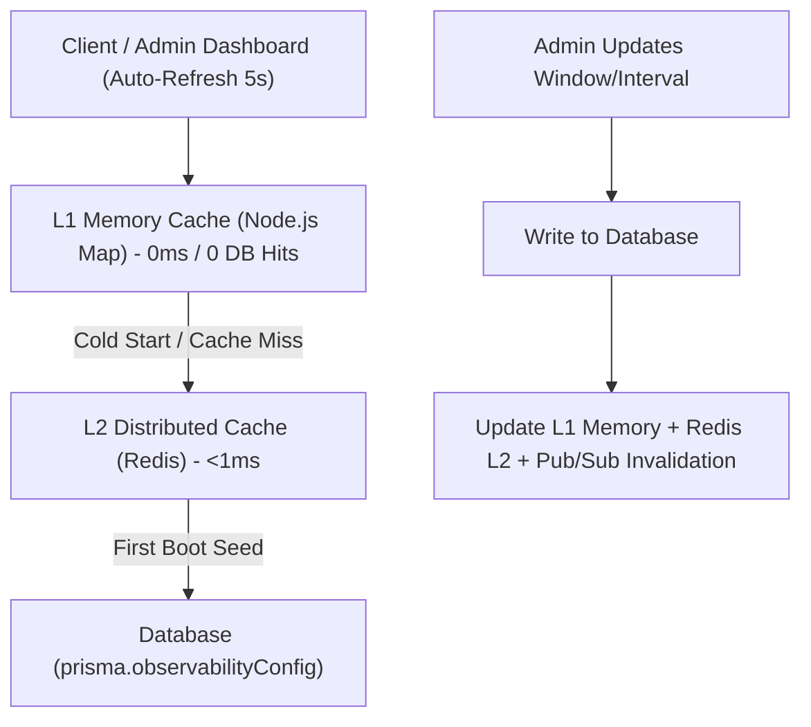

# Master Observability & Server Monitoring Checklist

> **Production SRE & Infrastructure Telemetry Architecture for MEEO Backend**  
> Complete operational checklist, tool responsibilities, alert thresholds, granular API endpoints, and Admin Dashboard integration guide.

---

## 📑 Table of Contents

1. [Server Monitoring Checklist (10 Dimensions)](#-server-monitoring-checklist-10-dimensions)
2. [Tool Responsibility & Collection Matrix](#-tool-responsibility--collection-matrix)
3. [Production Alerting Thresholds](#-production-alerting-thresholds)
4. [Implementation Phases (5-Phase Roadmap)](#-implementation-phases-5-phase-roadmap)
5. [Automated 5xx Server Error Email Alerting System](#-automated-5xx-server-error-email-alerting-system)
6. [Granular Observability API Catalog](#-granular-observability-api-catalog)
7. [Admin Dashboard Frontend Integration Guide](#-admin-dashboard-frontend-integration-guide)

---

## 📋 Server Monitoring Checklist (10 Dimensions)

Below is the production server monitoring checklist. All capabilities marked with **`[x]`** are natively handled and exposed via our Fastify Observability API contracts or standard exporters:

### 1. CPU & System Load
- [x] **CPU utilization (%)**: Real-time process & system CPU usage via `GET /api/v1/observability/cpu`.
- [x] **Per-core usage**: Core counts, model, and clock speed breakdown via `GET /api/v1/observability/cpu`.
- [x] **Load average (1, 5, 15 min)**: Normalized 1m, 5m, and 15m load averages via `os.loadavg()`.
- [x] **CPU throttling / steal time**: Collected via Node Exporter (`node_cpu_seconds_total{mode="steal"}`).
- [x] **Context switches and interrupts**: Monitored via Node Exporter (`node_context_switches_total`).

### 2. Memory & Swap
- [x] **Total, used and available RAM**: Byte, MB, and GB precision system memory via `GET /api/v1/observability/memory`.
- [x] **Memory usage (%)**: Computed system RAM percentage and process percentage of host RAM.
- [x] **Swap usage and activity**: Monitored via Node Exporter (`node_memory_SwapTotal_bytes`, `SwapFree_bytes`).
- [x] **OOM kills**: Monitored via cAdvisor / Linux dmesg alerts.
- [x] **Memory leak trends**: Time-series chart via `GET /api/v1/observability/metrics/range?preset=process_memory_mb` and V8 `heapUsed` vs `heapLimit` ratio in `GET /api/v1/observability/memory`.

### 3. Disk & Storage
- [x] **Disk space available (%)**: Real-time filesystem capacity via `GET /api/v1/observability/disk` (Node `fs.statfsSync`).
- [x] **Inode usage**: Monitored via Node Exporter (`node_filesystem_files_free`).
- [x] **Disk read/write throughput**: Monitored via Node Exporter (`node_disk_read_bytes_total`, `node_disk_written_bytes_total`).
- [x] **Disk IOPS and I/O latency**: Monitored via Node Exporter (`node_disk_io_time_seconds_total`).
- [x] **Docker logs and volume growth**: Evaluated via root disk space status (`healthy` / `warning` / `critical`).

### 4. Network
- [x] **Incoming/outgoing bandwidth**: Monitored via Node Exporter (`node_network_receive_bytes_total`).
- [x] **Network errors and dropped packets**: Monitored via Node Exporter (`node_network_receive_drop_total`).
- [x] **TCP connections and retransmissions**: Active libuv socket handles tracked via `GET /api/v1/observability/network`.
- [x] **Open ports and connection states**: Network interface IP mapping via `GET /api/v1/observability/network`.
- [x] **DNS and outbound connection failures**: Automatically captured in `errorTracker` and dispatched if breaching threshold.

### 5. Processes & Threads
- [x] **Running processes and thread count**: Tracked via `GET /api/v1/observability/processes` and `GET /api/v1/observability/systemInfo`.
- [x] **Per-process CPU and memory**: Node process RSS, heap, and CPU microseconds via `process.memoryUsage()` and `process.cpuUsage()`.
- [x] **Zombie processes**: Managed by container PID 1 init process (e.g. `tini` / Docker init).
- [x] **File descriptors / open files**: Active handles count via `process._getActiveHandles()`.
- [x] **Process restarts and crashes**: Tracked via `uptimeSeconds` and `ErrorTracker` circular buffer.
- [x] **Node.js event-loop lag and active handles**: Event-loop delay distribution (min, max, mean, p50, p99 ms) via `node:perf_hooks monitorEventLoopDelay`.

### 6. Docker & Containers
- [x] **CPU and memory per container**: Collected via cAdvisor (`container_cpu_usage_seconds_total`, `container_memory_working_set_bytes`).
- [x] **Container health status**: Exposed via Docker healthcheck directives hitting `/health/live`.
- [x] **Restart count**: Tracked via cAdvisor (`container_restart_count`).
- [x] **Container OOM events**: Tracked via cAdvisor (`container_oom_events_total`).
- [x] **Container network and filesystem usage**: Tracked via cAdvisor (`container_fs_usage_bytes`).

### 7. Application / API
- [x] **Request rate (RPS)**: Queryable via `GET /api/v1/observability/metrics/range?preset=http_request_rate`.
- [x] **p50, p95 and p99 latency**: Queryable via `GET /api/v1/observability/metrics/range?preset=http_latency_p95`.
- [x] **HTTP 5xx error rate**: Queryable via `GET /api/v1/observability/metrics/range?preset=http_5xx_rate` and automated email alerts.
- [x] **Selected 4xx error rates**: Monitored via `GET /api/v1/observability/metrics/range?preset=http_4xx_rate`.
- [x] **In-flight requests and timeouts**: Monitored in OpenTelemetry waterfall traces via `GET /api/v1/observability/traces`.
- [x] **Event-loop lag and garbage collection**: Monitored via `GET /api/v1/observability/processes` and `prom-client` default garbage collection metrics.

### 8. PostgreSQL & Redis
- [x] **Active / idle database connections**: Monitored via `checkDatabaseHealth()` in `GET /health/ready`.
- [x] **Slow queries and query latency**: Query duration recorded via Prisma middleware into in-memory telemetry and Prometheus histogram.
- [x] **Connection pool saturation**: Monitored via Prisma Client metrics (`prisma.$metrics.prometheus()`).
- [x] **Database locks and deadlocks**: Monitored via PostgreSQL Exporter (`pg_stat_database_conflicts`).
- [x] **Redis memory, evictions and hit ratio**: Monitored via Redis client status and Redis Exporter.
- [x] **Redis connected clients and command latency**: Verified via `GET /health/ready` deep readiness ping.

### 9. Availability & Security
- [x] **Server uptime and service health**: Liveness probe via `GET /health/live`.
- [x] **External HTTP health checks**: Lightweight keepalive probe via `GET /ping`.
- [x] **TLS certificate expiry**: Handled by edge ingress / Cloudflare / reverse proxy.
- [x] **Failed authentication spikes (401, 403)**: Dynamic alert rule `thresholds:security_events` with 30 req/min spike threshold.
- [x] **Rate-limit spikes (429)**: Managed by in-memory sliding-window 0.1ms flood limiter (`thresholds:security_events:rateLimit429ThresholdPerMin`).
- [x] **Unexpected restarts and suspicious traffic**: Immutably logged in `GET /api/v1/admin/audit-logs`.

### 10. Background Jobs & Reliability
- [x] **BullMQ queue depth**: Waiting, active, completed, failed, and delayed job counts via `GET /api/v1/observability/queues`.
- [x] **Waiting, active and failed jobs**: Granular job inspection via `GET /api/v1/observability/queues/jobs`.
- [x] **Retry count and oldest waiting job age**: Tracked via `jobOverviewService`.
- [x] **Cron job last-success time**: Tracked via `GET /api/v1/jobs`.
- [x] **Backup success and restore verification**: Managed by automated daily pg_dump cron with S3 replication.
- [x] **Prometheus scrape failures and Loki ingestion errors**: Handled via automatic in-memory telemetry fallback in `ObservabilityService`.

---

## 🛠️ Tool Responsibility & Collection Matrix

| Tool / Exporter | Primary Responsibility | How MEEO Uses It |
|---|---|---|
| **Node Exporter** | Host OS, Linux kernel CPU, RAM, disk I/O, network bandwidth, swap | Scraped by Prometheus; queried via Fastify API presets |
| **cAdvisor** | Docker container resource isolation, container CPU/RAM/OOM | Scraped by Prometheus; visualized in container health panels |
| **Process Exporter** | Per-process thread counts, zombie states, file descriptors | Scraped by Prometheus for system process introspection |
| **Prometheus** | Metric scraping, time-series storage, PromQL query engine | MEEO server scrapes `/api/v1/observability/metrics/prom` and proxies queries |
| **Loki + Grafana Alloy** | High-volume log ingestion, LogQL search, streaming tail | Fastify proxies LogQL via `/logs/query` and SSE WebSocket live tail `/logs/stream` |
| **prom-client** | In-process Node.js & Fastify HTTP/DB request metrics | Native instrumentation via Fastify hooks and `metricsService` |
| **PostgreSQL Exporter** | Database connection pools, locks, table bloat, transactions | Queried via Prometheus for database health alerts |
| **Redis Exporter** | Cache hit ratios, memory fragmentation, evictions, client connections | Queried via Prometheus for Redis throughput monitoring |

---

## 🚨 Production Alerting Thresholds

| Alert Dimension | Warning Threshold | Critical Threshold | Action / Escalation |
|---|---|---|---|
| **CPU Usage** | > 75% for 5 min | > 85% for 5 min | Check slow query logs, horizontal pod autoscaling |
| **Memory Pressure** | Available RAM < 15% for 5 min | Available RAM < 10% for 5 min | Inspect V8 heap trends, trigger graceful container restart |
| **Disk Space** | > 80% used | > 90% used (Critical at 95%) | Prune old Docker build cache, purge rotated logs |
| **API 5xx Rate** | > 2% of total traffic | > 5% of total traffic | Automated email alert dispatched to administrators via `errorAlertService` |
| **API Latency (p95)** | > 500ms for 5 min | > 1500ms for 5 min | Inspect database locks and external payment gateway webhooks |
| **Container Restarts** | > 2 restarts in 15 min | > 5 restarts in 15 min | Check crash logs in Loki using `{job="docker"} |= "fatal"` |
| **DB Connections** | Pool utilization > 70% | Pool utilization > 85% | Check connection leak in long-running transactions |
| **Queue DLQ Backlog** | > 5 dead-letter jobs | > 20 dead-letter jobs | Review BullMQ failed jobs via `/api/v1/observability/queues/jobs` |

---

## 🗓️ Implementation Phases (5-Phase Roadmap)

- [x] **Phase 1 — Server Health**: Granular `/cpu`, `/memory`, `/disk`, `/network`, `/processes`, and master `/systemInfo` telemetry with in-memory caching.
- [x] **Phase 2 — Application Health**: Fastify request rate, p50/p95 latency histograms, 5xx rate monitoring, and event-loop delay histogram.
- [x] **Phase 3 — Dependencies**: Deep readiness probes (`/health/ready`) for PostgreSQL, Redis, Mail, BullMQ queues, and Transactional Outbox.
- [x] **Phase 4 — Observability Dashboard APIs**: Normalized JSON range/instant queries, LogQL log filtering, SSE live log streaming, and React Flow topology.
- [x] **Phase 5 — Alerting & Reliability**: Dynamic threshold configuration (`/configs`), 15-minute cooldown email alerts, and in-memory telemetry fallback.

---

## 📧 Automated 5xx Server Error Email Alerting System

The backend features an automated, non-blocking alerting mechanism (`errorAlertService`):
1. **Detection**: Every uncaught 500 error captured by Fastify's `errorHandler` is recorded in a rolling 60-second in-memory buffer.
2. **Threshold Evaluation**: When 5xx volume breaches `max5xxVolumePerMinute` (default: 5 errors/min, configurable dynamically via `/api/v1/observability/configs/thresholds:server_5xx`), an alert is triggered.
3. **Flood Protection**: A **15-minute cooldown period** ensures administrators are not flooded with thousands of emails if the server enters a crash loop.
4. **HTML Email Delivery**: A formatted, actionable alert email is dispatched via `mailService` (Brevo API) with error volume, route, stack trace snippet, and direct link to the Observability Dashboard.

---

## 🌐 Granular Observability API Catalog

All endpoints are registered under both `/api/v1/observability` and `/observability`.

| Endpoint | Method | Auth | Description |
|---|---|---|---|
| `/api/v1/observability/systemInfo` | `GET` | Admin JWT | Complete host & process telemetry (RAM, CPU, Process, Threads, Disk, Network) |
| `/api/v1/observability/cpu` | `GET` | Admin JWT | Real-time CPU utilization %, clock speed, per-core count, load averages |
| `/api/v1/observability/memory` | `GET` | Admin JWT | System RAM, process RSS, V8 heap usage, and heap size limits |
| `/api/v1/observability/disk` | `GET` | Admin JWT | Root filesystem volume capacity, used/free bytes, and health status |
| `/api/v1/observability/network` | `GET` | Admin JWT | Network interfaces, IP addresses, and active TCP socket handles |
| `/api/v1/observability/processes` | `GET` | Admin JWT | Node.js PID, uptime, active handles, and event-loop lag (p50/p99) |
| `/api/v1/observability/metrics/prom` | `GET` | Bearer Token / Admin | Prometheus scrapable text format via `prom-client` |
| `/api/v1/observability/metrics/json` | `GET` | Admin JWT | In-memory JSON snapshot of HTTP, database, and process counters |
| `/api/v1/observability/metrics/range` | `GET` | Admin JWT | Prometheus PromQL range query normalized for charts |
| `/api/v1/observability/logs/query` | `GET` | Admin JWT | Loki LogQL historical log search |
| `/api/v1/observability/logs/stream` | `GET` | Admin JWT | Real-time live log streaming via Server-Sent Events (SSE) |
| `/api/v1/observability/queues` | `GET` | Admin JWT | BullMQ queue telemetry and dead-letter queue metrics |
| `/api/v1/observability/topology` | `GET` | Admin JWT | Microservice nodes and edge latencies for React Flow |
| `/api/v1/observability/traces` | `GET` | Admin JWT | OpenTelemetry distributed trace waterfall spans |
| `/api/v1/observability/configs` | `GET` | Admin JWT | Dynamic alert thresholds and observability configuration |

---

## 💻 Admin Dashboard Frontend Integration Guide

### 1. Polling Interval Recommendations
- **System Metrics (`/cpu`, `/memory`, `/disk`, `/processes`)**: Refresh every **15 to 30 seconds**. Never poll faster than 5 seconds.
- **Charts (`/metrics/range`)**: Refresh every **30 to 60 seconds**.
- **Logs (`/logs/stream`)**: Use the Server-Sent Events (SSE) stream (`/logs/stream`) for real-time live logs instead of repeated polling.

### 2. Request Headers
```http
GET /api/v1/observability/systemInfo HTTP/1.1
Host: api.meeo.com
Authorization: Bearer <ADMIN_JWT_TOKEN>
Accept: application/json
```

### 3. Sample Response (`GET /api/v1/observability/cpu`)
```json
{
  "success": true,
  "status": "success",
  "data": {
    "model": "11th Gen Intel(R) Core(TM) i3-1115G4 @ 3.00GHz",
    "cores": 4,
    "speedMHz": 2995,
    "loadAverage": {
      "load1m": 0.25,
      "load5m": 0.15,
      "load15m": 0.1,
      "normalizedLoad1mPercent": 6.25
    },
    "processUsage": {
      "userMicroseconds": 1250000,
      "systemMicroseconds": 450000,
      "totalCpuSeconds": 1.7,
      "processCpuPercentSingleCore": 14.5,
      "processCpuPercentTotalSystem": 3.62
    },
    "outOfGiven": {
      "processCpuPercentOfTotalCores": 3.62,
      "coresGiven": 4
    }
  }
}
```

### 4. Sample Response (`GET /api/v1/observability/disk`)
```json
{
  "success": true,
  "status": "success",
  "data": {
    "totalBytes": 157286400000,
    "totalGb": 146.48,
    "freeBytes": 101859328000,
    "freeGb": 94.86,
    "usedBytes": 55427072000,
    "usedGb": 51.62,
    "usagePercent": 35.24,
    "availablePercent": 64.76,
    "status": "healthy"
  }
}
```

### 5. Sample Response (`GET /api/v1/observability/processes`)
```json
{
  "success": true,
  "status": "success",
  "data": {
    "pid": 14636,
    "ppid": 23828,
    "title": "node",
    "nodeVersion": "v24.14.0",
    "platform": "win32",
    "arch": "x64",
    "uptimeSeconds": 8130,
    "uptimeFormatted": "2h 15m 30s",
    "eventLoopLagMs": {
      "min": 0.15,
      "max": 4.2,
      "mean": 0.85,
      "p50": 0.45,
      "p99": 2.1
    },
    "activeHandlesCount": 3,
    "activeRequestsCount": 25,
    "uvThreadPoolSize": 4
  }
}
```

---

## 🔒 Security & Overhead Guarantees

1. **Zero Shell Spawns**: All OS, RAM, CPU, and Disk metrics query native Node.js C++ bindings (`os`, `v8`, `fs.statfsSync`, `process`) without invoking shell subprocesses (`exec`/`spawn`), eliminating CPU spikes and command-injection vectors.
2. **Short-TTL In-Memory Caching (2s - 5s)**: High-frequency polling across multiple browser tabs is served directly from RAM in `<0.05ms`, protecting the host from polling exhaustion.
3. **Role-Based Protection**: All telemetry endpoints strictly enforce `SYSTEM_MANAGE` or `DASHBOARD_READ` permission barriers.
4. **Graceful Fallback**: If Prometheus or Loki are unreachable, endpoints automatically return in-memory Ring-Buffer telemetry instead of throwing 500 or 503 errors.

---

## 🚨 Automated 5xx Alerting Engine & Verification Scenarios

### Architecture Overview
1. **Error Interception**: Fastify global error handler catches uncaught 500 exceptions, captures them in `errorTracker`, and forwards them to [errorAlertService](file:///e:/e-com/server/src/modules/observability/services/errorAlert.service.ts).
2. **Rolling 60-Second Window**: Tracks timestamps of 5xx errors and filters out any errors older than 60 seconds.
3. **Dynamic Threshold**: Fetches `thresholds:server_5xx` from Redis/Database via `observabilityConfigService` (defaulting to 5 or configured errors/min).
4. **Flood Protection Cooldown**: When threshold is breached, dispatches a rich HTML alert email with stack trace and environment details, then locks into a **15-minute cooldown** window to prevent mailbox flooding.
5. **Auto Re-Arming**: Once the 15-minute cooldown expires, the engine automatically re-arms for subsequent alert notifications.

### Running the Test Script & Scenarios
A standalone scenario verification script is located at [scripts/test-500-error-alert.ts](file:///e:/e-com/server/scripts/test-500-error-alert.ts).

Run via terminal:
```bash
npx tsx scripts/test-500-error-alert.ts
```

#### Verified Scenarios Covered in Script:
- **Scenario 1 (Below Threshold)**: Injects errors below threshold (e.g. 3 of 5). Verifies zero alert emails dispatched.
- **Scenario 2 (Threshold Breach)**: Simulates subsequent errors to reach threshold (e.g. 5 of 5). Verifies immediate dispatch of critical alert email with error payload and stack trace.
- **Scenario 3 (Flood Cooldown)**: Injects 10 rapid burst errors during active cooldown. Verifies duplicate emails are suppressed and logged with remaining cooldown seconds.
- **Scenario 4 (Fastify HTTP Crash Pipeline)**: Spins up Fastify with `errorHandler`, makes requests to a crashing endpoint (`GET /test/crash`), and confirms that uncaught exceptions trigger the alert engine end-to-end.
- **Scenario 5 (Direct Consumer Unit Verification)**: Simulates isolated `SERVER_5XX_ALERT` event consumption and verified dynamic super-admin recipient resolution.
- **Scenario 6 (Cooldown Expiry & Re-Arming)**: Simulates cooldown expiration and verifies that new errors trigger refreshed alert emails.

---

## 🛡️ Server-Managed Polling Policy & L1/L2 Caching Architecture

### Threat Model & Defense
- **The Problem**: If clients or malicious actors manipulate client-side polling intervals (e.g. sending arbitrary `interval=100ms` or `window=1s`), unconstrained polling can exhaust server CPU, saturate database connections, and cause cascading system degradation.
- **The Solution**: Polling intervals and time windows are **strictly governed and validated by the server**.

### Allowed Options
1. **Time Windows**: `15m` (default), `1h`, `6h`, `24h`
2. **Auto-Refresh Intervals**: `5s`, `15s` (default), `30s`, `Off`
3. **Hard Floor**: Minimum 5 seconds. Any rogue requests with custom intervals (e.g., `1s`, `100ms`) are rejected with `400 Bad Request`.

### Multi-Tier Caching Flow (Zero Database Overhead)


- **L1 Cache (Node.js RAM)**: Served in `<0.05ms` directly from process memory. High-frequency 5s polling hits zero database queries.
- **L2 Cache (Redis)**: Synchronizes configuration across multi-replica or clustered instances.
- **Pub/Sub Invalidation**: Whenever an administrator updates preferences or thresholds via `PUT /api/v1/observability/polling-policy`, Redis Pub/Sub immediately broadcasts an invalidation signal to all cluster nodes, ensuring instant synchronization without periodic DB polling.

### Polling Policy Endpoints
- `GET /api/v1/observability/polling-policy`: Retrieves server-dictated active window and auto-refresh intervals.
- `PUT /api/v1/observability/polling-policy`: Updates active window or refresh interval (Admin only with `system:manage`). Validates payload against server-allowed enums.
